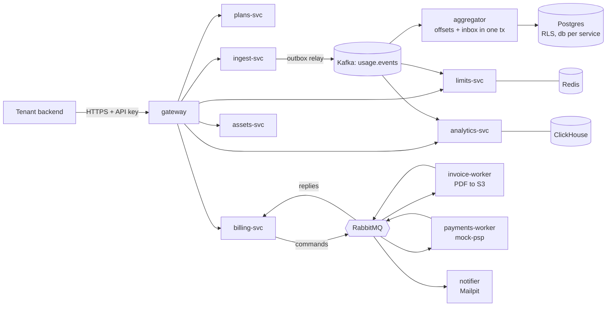

# Quotify

> Multi-tenant usage metering and billing in Go: Kafka, RabbitMQ, gRPC, Postgres Row Level Security, ClickHouse, Kubernetes.

Quotify lets a SaaS company (a *tenant*) send usage events, "customer X used 1,500 AI tokens", "customer Y made one API call",
and turns them into correct, auditable invoices. It is in the same family as Orb, Lago and Stripe's usage-based billing.
It is also a worked example of getting distributed-systems guarantees right and *proving* them: every claim below has a test
that kills things.

```bash
make tools up                  # Compose: infra, observability, all services (needs ~3 GiB for Docker)
make demo                      # the story below, end to end, in about two and a half minutes
make e2e                       # the public API against the real stack
make chaos N=100000            # exact totals while replicas are killed, connections reset, a broker stopped
```

## Correctness in 60 seconds

| Guarantee | How | Proof |
|---|---|---|
| An acknowledged event is never lost | `202` only after a durable Postgres write; a **transactional outbox** feeds Kafka | Kafka outage test: nothing lost, order per key kept |
| An event is never counted twice | Idempotency key per tenant at the edge, then **offset and aggregate in one Postgres transaction** downstream (no dual write anywhere) | Crash-after-commit hooks; the chaos suite compares every aggregate with a ledger, with zero tolerance |
| Late events do not corrupt a closed month | Period and lateness come from event fields, never from the consumer's clock; a late event is billed as an adjustment on the next invoice | Late-usage integration tests; `A2` of the chaos suite |
| A payment is never charged twice | An **orchestrated saga** (billing-svc) with a state table; every command id is deterministic, the PSP is called with one idempotency key per attempt; an unknown outcome asks the PSP before anything is retried | A random-replies test, `PAYMENT_UNKNOWN` scenarios, a RabbitMQ restart in the middle of a month close |
| Bad data can be fixed after the fact | Kafka is the log. **Replay** rebuilds one tenant into a new generation, verifies the difference, and promotes it with live traffic flowing; **re-rating** bills only the price difference | Replay promotes under load with an exact ledger check (it found a real lock-snapshot bug, see the history) |
| Tenants cannot see each other | Shared schema with **forced RLS** on every table, a role per purpose, tenant context set per transaction | RLS isolation tests, and a check in CI that every table of every service has row security forced |
| Limits are enforced at the speed of Redis, and are right in the end | Atomic Lua counters, thresholds fired once, a reconcile loop against the authoritative aggregates | Redis flushed and restarted mid-run; counters rebuild and match (A4) |

Money is never a float: unit prices are decimals, amounts are `int64` minor units rounded half-even once per line,
quantities are exact scaled integers ([ADR 0010](docs/adr/0010-money-and-quantity-representation.md)).

## Architecture



Facts go on Kafka, commands on RabbitMQ; each service owns its database; every side effect has a natural dedup key.
The long version is in [docs/02-architecture.md](docs/02-architecture.md); how the hard problems are solved is in
[docs/07-correctness.md](docs/07-correctness.md).

## The demo

`make demo` creates an account in the **sandbox** (test keys, a mock payment provider, deterministic payment scenarios, on-demand
period close), sends usage, closes the period with the real workers, raises the price, and re-rates the closed period:

<details><summary>Output of <code>make demo</code> on a laptop</summary>

```text
==> 1/7 A new account: sandbox and live tenants, a plan, six customers (one per payment scenario)
sandbox tenant 01a15217-773c-7a50-9756-9ea59d6d57ef

==> 2/7 Usage: 600 events (AI tokens and GB-hours) through POST /v1/events, 5 % of them sent twice

==> 3/7 Close the period now (sandbox ClosePeriodNow): watermark, rating, invoice numbers, the saga with real workers
closing 2026-10
  ... waiting for the invoices
  ... 1 of 6 invoices final
  ... 3 of 6 invoices final
  ... 4 of 6 invoices final
  ... 5 of 6 invoices final
done: 6 of 6 invoices final
  ... billing run RUN_STATUS_INVOICING
done: billing run RUN_STATUS_COMPLETED
NUMBER             KIND        TOTAL     STATUS         SAGA
SBX-2026-000001    REGULAR     9949      uncollectible  COMPLETED
SBX-2026-000002    REGULAR     11617     paid           COMPLETED
SBX-2026-000003    REGULAR     9955      paid           COMPLETED
SBX-2026-000004    REGULAR     11895     paid           COMPLETED
SBX-2026-000005    REGULAR     9954      paid           COMPLETED
SBX-2026-000006    REGULAR     9950      paid           COMPLETED

==> 4/7 A price change: a new version of the plan, 20 % dearer base fee and GB-hours
plan version 2 (id 01a15218-d0e1-7a34-9700-88a9e86d3149)

==> 5/7 Re-rating 2026-10 under the new version: the difference becomes one CORRECTION invoice per customer
job d528b891-02d1-4992-af5f-929f64c5f3b0: 6 customers rated, 6 corrections totalling 12742 minor units
asking again returns the same job (d528b891-02d1-4992-af5f-929f64c5f3b0) and changes nothing

==> 6/7 The correction invoices go through the same saga: PDF, charge, receipt
  ... 0 of 6 correction invoices final
  ... 1 of 6 correction invoices final
  ... 3 of 6 correction invoices final
  ... 4 of 6 correction invoices final
  ... 5 of 6 correction invoices final
done: 6 of 6 correction invoices final
NUMBER             KIND        TOTAL     STATUS         SAGA
SBX-2026-000007    CORRECTION  2399      paid           COMPLETED
SBX-2026-000008    CORRECTION  2000      paid           COMPLETED
SBX-2026-000001    REGULAR     9949      uncollectible  COMPLETED
SBX-2026-000009    CORRECTION  2000      paid           COMPLETED
SBX-2026-000010    CORRECTION  2343      paid           COMPLETED
SBX-2026-000011    CORRECTION  2000      paid           COMPLETED
SBX-2026-000002    REGULAR     11617     paid           COMPLETED
SBX-2026-000003    REGULAR     9955      paid           COMPLETED
SBX-2026-000004    REGULAR     11895     paid           COMPLETED
SBX-2026-000005    REGULAR     9954      paid           COMPLETED
SBX-2026-000006    REGULAR     9950      paid           COMPLETED
SBX-2026-000012    CORRECTION  2000      uncollectible  COMPLETED

==> 7/7 Where to look
Mailpit has 18 messages, for example:
  - [SANDBOX] Payment failed for invoice SBX-2026-000012
  - [SANDBOX] Receipt for invoice SBX-2026-000010
  - [SANDBOX] Receipt for invoice SBX-2026-000011
  - [SANDBOX] Receipt for invoice SBX-2026-000008
  - [SANDBOX] Receipt for invoice SBX-2026-000009
  - [SANDBOX] Receipt for invoice SBX-2026-000007

  Mailpit (receipts)   http://localhost:8025
  Grafana (dashboards) http://localhost:3000   Quotify / Billing, Pipeline lag, Correctness
  Traces (Tempo)       http://localhost:3000/explore   (data source Tempo)
  MinIO (PDFs)         http://localhost:9002   (user quotify, password quotify_local)
  Redpanda Console     http://localhost:8085
```

</details>

Nothing in it is mocked except the payment provider and the clock of the period (a sandbox tenant can close "now").

## Measured, not claimed

The numbers are in [docs/benchmarks.md](docs/benchmarks.md), with hardware, method and the raw k6 and chaos artifacts. On an M4 laptop
with a 2.9 GiB Docker VM running everything: 5,000 events/s sustained at p99 32 ms with no errors, 289 s to close a month for 10,000
customers x 5 meters, exact totals under chaos (container kills, resets, a broker stop, a wiped Redis), and, stated plainly, two targets missed on that machine
(latency at a 20,000 events/s spike; entitlement reads p99 at 2,000/s). The 1M-event nightly is wired in CI and has not run yet.

## What is in the repository

| Path | |
|---|---|
| `services/` | gateway, plans-svc, ingest-svc, aggregator, limits-svc, billing-svc, analytics-svc, assets-svc, invoice-worker, payments-worker, notifier |
| `tools/` | `quotifyctl` (seed, demo, replay, rerate, DLQ redrive), `mockpsp` |
| `pkg/` | the shared kit: Kafka and RabbitMQ toolkits, outbox, tenancy, Postgres helpers, OpenTelemetry setup, test containers |
| `proto/`, `gen/go/` | Protobuf contracts (`buf breaking` in CI); generated code is committed |
| `deploy/` | Compose, Helm charts (`quotify`, `quotify-infra`), kind, Prometheus rules, Grafana dashboards, OpenTelemetry collector |
| `tests/` | e2e, the chaos and correctness suite, k6 scenarios, benchmarks, Helm render tests |
| `docs/` | design, 14 ADRs, the phase plan, [benchmarks](docs/benchmarks.md) |

| Concern | Choice |
|---|---|
| Services | Go, gRPC (`buf`), Go workspace monorepo |
| Event log (facts) | Kafka API (Redpanda), `franz-go` |
| Task queue (commands) | RabbitMQ quorum queues, `amqp091-go`, delay-queue retries |
| OLTP | PostgreSQL, `pgx` + `sqlc`, database per service, Row Level Security |
| Counters and rate limits | Redis (Lua) |
| Analytics | ClickHouse |
| Object storage | S3 API (MinIO locally and in kind), multipart multi-file uploads |
| Observability | OpenTelemetry, Prometheus, Grafana, Tempo, `slog`; alert rules unit-tested with `promtool` |
| Testing | `testcontainers-go`, k6, a chaos and correctness suite |
| Deploy | Docker Compose, kind + Helm (NetworkPolicies, migration hooks, zero-downtime rollouts), GitHub Actions |

## Status

Phases 00 to 11 are implemented ([roadmap](docs/phases/ROADMAP.md)): foundation, plans and gateway, ingest, aggregator, limits, billing
saga, workers, analytics and assets, observability, correctness and load, Kubernetes, replay and re-rating. Phase 12 (an operator
UI) is optional. What is *not* done is listed where it is relevant: the benchmark report names its misses, the Kubernetes doc its
gaps, and the phase files their open boxes.

## Start here

- [Vision](docs/00-vision.md): the problem, goals and non-goals
- [Architecture](docs/02-architecture.md) and [Correctness](docs/07-correctness.md)
- [Local development](docs/10-local-dev.md), [Kubernetes](docs/12-kubernetes.md), [Testing strategy](docs/09-testing-strategy.md)
- [Decisions](docs/adr/): why each technology was chosen

## License

TODO: add the Apache-2.0 `LICENSE` file when the repository goes public (decided, not yet added while the repo is private).
