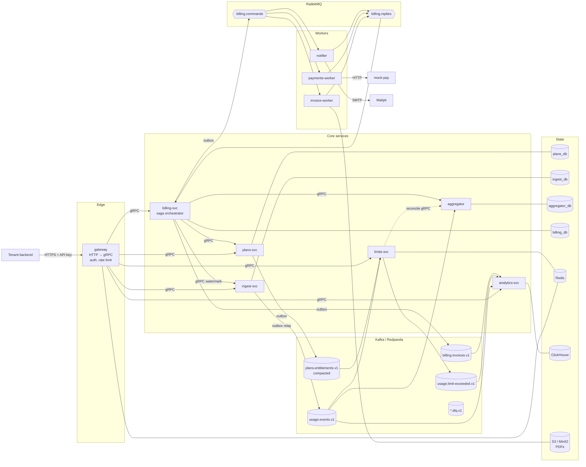
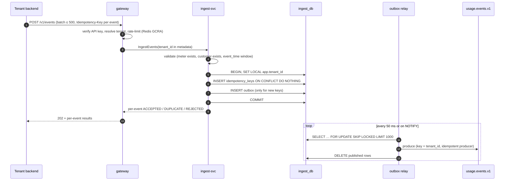
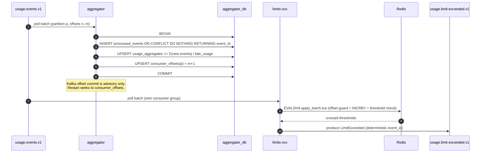
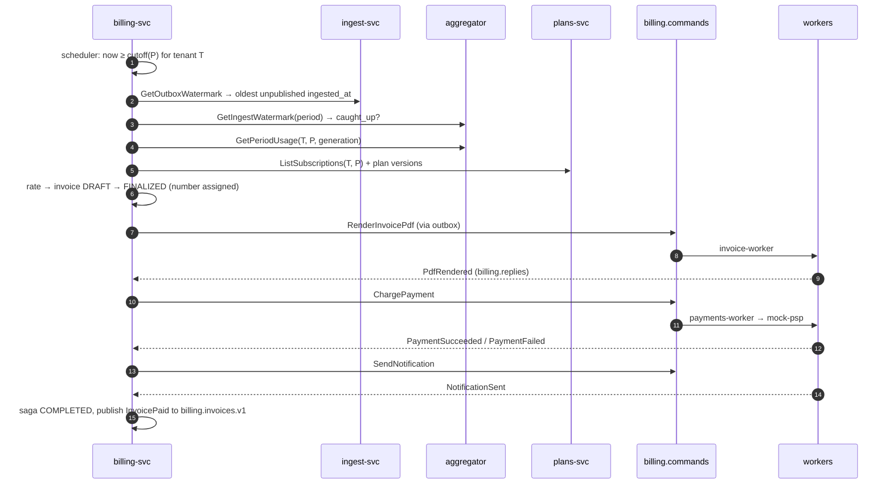

# 02 — Architecture

## Principles

1. **Facts on Kafka, commands on RabbitMQ.** Kafka = event log (facts, replayable).
   RabbitMQ = task queue (commands, retries). See [ADR 0002](adr/0002-kafka-for-event-log.md) and [ADR 0003](adr/0003-rabbitmq-for-commands.md).
2. **Database per service.** No service reads another service's tables. Cross-service reads go
   through gRPC or a published topic.
3. **Every side effect is idempotent.** Each write has a natural dedup key, and the docs name it.
4. **No dual writes.** A DB write plus a message publish always goes through an outbox ([ADR 0009](adr/0009-transactional-outbox-and-inbox.md)).
5. **Aggregation and rating are separate.** Quantities are facts. Prices are applied later by a pure function.
   This makes re-rating cheap and safe.
6. **Determinism over wall clocks.** Period assignment and lateness come from event fields
   (`event_time`, `ingested_at`), never from "when the consumer happened to see it".

## System diagram

## Service map

| Service | Kind | Owns | In | Out |
|---|---|---|---|---|
| [gateway](03-services/gateway.md) | Stateless edge | — (Redis keys for rate limits and API-key cache) | HTTP/JSON | gRPC |
| [plans-svc](03-services/plans-svc.md) | gRPC service | `plans_db` | gRPC | `plans.entitlements.v1` (outbox) |
| [ingest-svc](03-services/ingest-svc.md) | gRPC service + relay | `ingest_db` | gRPC | `usage.events.v1` (outbox) |
| [aggregator](03-services/aggregator.md) | Kafka consumer + gRPC | `aggregator_db` | `usage.events.v1` | gRPC reads, `usage.events.dlq.v1` |
| [limits-svc](03-services/limits-svc.md) | Kafka consumer + gRPC | Redis `lim:*` keys | `usage.events.v1`, `plans.entitlements.v1` | `usage.limit-exceeded.v1` |
| [billing-svc](03-services/billing-svc.md) | Saga orchestrator + gRPC | `billing_db` | gRPC, `billing.replies` | `billing.commands`, `billing.invoices.v1` |
| [invoice-worker](03-services/workers.md#invoice-worker) | RabbitMQ worker | S3 bucket `invoices` (MinIO locally, [ADR 0013](adr/0013-s3-compatible-object-storage.md)) | `invoice.render` | `billing.replies` |
| [payments-worker](03-services/workers.md#payments-worker) | RabbitMQ worker | `payments_db` | `payment.charge` | `billing.replies` |
| [notifier](03-services/workers.md#notifier) | RabbitMQ worker | `notifier_db` | `notification.send` | `billing.replies` |
| [analytics-svc](03-services/analytics-svc.md) | Kafka consumer + gRPC | ClickHouse `quotify` DB | `usage.events.v1`, `usage.limit-exceeded.v1`, `billing.invoices.v1` | gRPC reads |
| [assets-svc](03-services/assets-svc.md) | gRPC service | `assets_db` + S3 prefix `{tenant}/assets/` | gRPC (incl. client streaming) | presigned S3 URLs |
| mock-psp | Fake external HTTP API; the sandbox payment provider ([ADR 0011](adr/0011-sandbox-environment.md)) | own Postgres schema | HTTP | — |

## Flow 1 — Ingest

The client gets `202` only after the commit, so an acknowledged event is never lost.
Publishing is at-least-once: the relay can crash after producing and before deleting.
Downstream dedups on `event_id`.

## Flow 2 — Aggregation and limits

## Flow 3 — Period close and invoice saga

Full state machine: [03-services/billing-svc.md](03-services/billing-svc.md#saga-state-machine).

## Synchronous dependencies (gRPC)

| Caller | Callee | Method(s) | On callee outage |
|---|---|---|---|
| gateway | plans-svc | `ResolveApiKey` | Serve from Redis cache (60 s TTL). After expiry → `503` |
| gateway | ingest-svc | `IngestEvents` | `503` + `Retry-After`. Client retries with the same idempotency keys |
| ingest-svc | plans-svc | `GetMeter`, `ResolveCustomer` | In-process LRU + Redis cache. Cache miss on outage → `UNAVAILABLE` |
| limits-svc | aggregator | `GetUsageBatch` (reconcile) | Skip the reconciliation cycle. Alert if skipped > 3 times |
| billing-svc | ingest-svc, aggregator, plans-svc | watermark, usage, subscriptions | Billing run waits (state `WAITING_WATERMARK`) and retries with backoff |

The hot path (ingest) has exactly one synchronous hop after the gateway. Plans lookups on it are cached.

## Environments

| Level | Sandbox | Live |
|---|---|---|
| Tenant (every deployment) | `qk_test_` keys → sandbox tenant. Payments always via mock-psp with scenario tokens. Early period close. `SBX-` invoices | `qk_live_` keys → live tenant. Payments via `PAYMENTS_LIVE_PROVIDER` (v1: mock-psp in the local demo only) |
| Deployment | Compose default and kind `values-kind.yaml` run both. `values-sandbox.yaml` (namespace `quotify-sandbox`) runs sandbox-only, for a public demo | — (no production deployment in scope) |

## Deployment shape

- Every service is a single Go binary from `services/<name>/cmd/<name>`.
- Stateless replicas behind Kubernetes Services. Kafka consumers scale up to the partition count
  (`usage.events.v1` has 12 partitions → ≤ 12 aggregator pods).
- ingest-svc runs the HTTP-free gRPC server and the outbox relay in the same binary.
  The relay is a separate goroutine pool with `SKIP LOCKED`, so many replicas are safe.
- billing-svc's scheduler uses a Postgres advisory lock per `(tenant_id, period_id)` so only one pod
  drives a given billing run.
