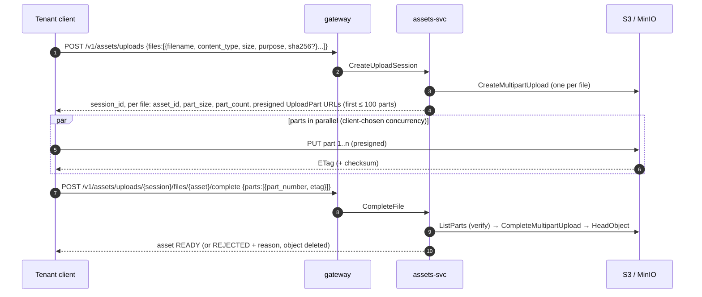
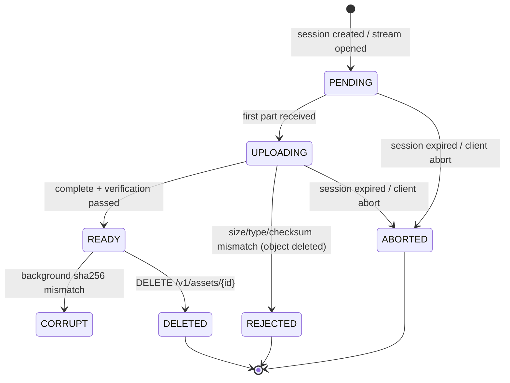

# assets-svc

## Responsibility

Store tenant files (invoice logos, invoice attachments, general files) in S3-compatible object storage
([ADR 0013](../adr/0013-s3-compatible-object-storage.md)) with **multipart, multi-file uploads**:

- **Direct multipart upload (large files, many files):** the client opens one upload session for up to 50 files, gets
  presigned S3 `UploadPart` URLs, uploads parts **in parallel directly to S3**, then completes each file. Bytes never pass
  through the gateway or assets-svc.
- **Proxied `multipart/form-data` (small files):** one HTTP request carries up to 20 files. The gateway streams each part
  (no buffering to memory or disk) through a gRPC client stream to assets-svc, which writes it to S3 with a server-side
  multipart upload.

It owns asset metadata and lifecycle. It knows nothing about billing. invoice-worker reads the logo object by key from the command.

## Upload flows

### A. Direct multipart (presigned)



| Rule | Value |
|---|---|
| Files per session | ≤ 50 |
| Part size | Chosen by assets-svc: `max(8 MiB, ceil(size / 10,000))`, so S3's 5 MiB minimum and 10,000-part maximum hold. The last part can be smaller |
| Max file size | Per purpose (below). Hard cap 5 GiB in v1 |
| Presigned URL TTL | 15 min. More URLs via `POST …/files/{asset}/parts?from=101` (also for refreshing expired ones) |
| Integrity | Each part URL is signed with `x-amz-checksum-sha256` when the client declares per-part checksums. Otherwise `CompleteFile` checks that `Σ part sizes == declared size` from `ListParts` (it never trusts client-reported sizes). Optional whole-file `sha256` is checked by a background verifier, which marks the asset `CORRUPT` on mismatch |
| Session expiry | 24 h. The sweeper aborts open multipart uploads (`AbortMultipartUpload`) and marks the files `ABORTED`. A bucket lifecycle rule `AbortIncompleteMultipartUpload: 2 days` is the backstop |
| Idempotency | `Idempotency-Key` on session creation (same key → same session and asset IDs). `CompleteFile` on a `READY` asset returns it unchanged |
| Resume | `GET /v1/assets/uploads/{session}/files/{asset}` returns the parts S3 already has (`ListParts`), so a client can re-upload only the missing ones |

### B. Proxied `multipart/form-data`

```
POST /v1/assets            Content-Type: multipart/form-data; boundary=…
  part "metadata" (JSON, optional, first): {"files":{"logo.png":{"purpose":"invoice_logo"}}}
  part "file" filename="logo.png"
  part "file" filename="terms.pdf"
```

- The gateway reads with `mime/multipart.Reader` (`NextPart`), never `ParseMultipartForm`, so memory is bounded by one chunk.
- Each file → one gRPC client-streaming `UploadAsset` call (header message, then 256 KiB chunks). assets-svc pipes the stream into
  S3 with the SDK upload manager (multipart, 8 MiB parts, 4 concurrent parts per file).
- Limits: ≤ 20 files, ≤ 25 MiB per file, ≤ 100 MiB per request (`413` beyond). Rate class `write`, charged **per file**.
- The response is `200` with per-file results in order (`created` + asset, or `rejected` + `error_code`), like the events batch.
  A file failing validation doesn't fail the others.

## Validation and security

| Check | Where | Error code |
|---|---|---|
| Purpose known, content type in the purpose allowlist | session creation / first chunk | `UNSUPPORTED_CONTENT_TYPE` |
| Content sniffing (`http.DetectContentType` on the first 512 bytes) agrees with the declared type | proxied: first chunk. Direct: background verifier → `REJECTED` | `CONTENT_TYPE_MISMATCH` |
| Size within the purpose limit and the tenant's storage quota (tier) | session creation + completion | `FILE_TOO_LARGE`, `STORAGE_QUOTA_EXCEEDED` |
| Filename sanitized (NFC, no path separators or control chars, ≤ 255 bytes). Never used in the object key | always | `INVALID_FILENAME` |
| Object key `{tenant_id}/assets/{asset_id}`. Presigned URLs are generated only for the caller tenant's own upload IDs | assets-svc | — |
| Download via presigned GET (5 min) with `response-content-disposition: attachment` | `GET /v1/assets/{id}/download` | — |

| Purpose | Allowed types | Max size |
|---|---|---|
| `invoice_logo` | `image/png`, `image/jpeg` (no SVG: script risk in PDFs and browsers) | 2 MiB |
| `invoice_attachment` | `application/pdf` | 25 MiB |
| `general` | allowlist in config (`pdf`, `png`, `jpeg`, `csv`, `json`, `zip`) | 5 GiB |

Malware scanning is out of scope. The state machine has a `SCANNING` slot so a scanner can be plugged in later.

## Asset state machine



## gRPC API (sketch)

```proto
package quotify.assets.v1;

service AssetsService {
  rpc CreateUploadSession(CreateUploadSessionRequest) returns (UploadSession);       // direct multipart, ≤ 50 files
  rpc PresignParts(PresignPartsRequest) returns (PresignPartsResponse);              // more/refreshed part URLs
  rpc GetUploadFile(GetUploadFileRequest) returns (UploadFile);                      // includes uploaded parts (resume)
  rpc CompleteFile(CompleteFileRequest) returns (Asset);
  rpc AbortUpload(AbortUploadRequest) returns (UploadSession);                       // whole session or one file
  rpc UploadAsset(stream UploadAssetChunk) returns (Asset);                          // proxied form-data, one file per stream
  rpc GetAsset(GetAssetRequest) returns (Asset);
  rpc ListAssets(ListAssetsRequest) returns (ListAssetsResponse);
  rpc GetDownloadUrl(GetDownloadUrlRequest) returns (GetDownloadUrlResponse);
  rpc DeleteAsset(DeleteAssetRequest) returns (Asset);
}

message UploadAssetChunk {
  oneof msg {
    UploadHeader header = 1;   // first message: filename, declared content_type, purpose, optional size
    bytes chunk = 2;           // ≤ 256 KiB each
  }
}
```

## Owned data (`assets_db`)

`upload_sessions`, `assets`. DDL in [05-data-model.md](../05-data-model.md#assets_db).
All tables are RLS'd for `assets_app`. The sweeper and verifier run as `assets_system`.

## Consumed / produced messages

None in v1. A ready asset is referenced by ID (e.g. `tenants.invoice_logo_asset_id` in plans-svc, copied into `RenderInvoicePdf`).

## Failure modes

| Failure | Behaviour |
|---|---|
| Client disconnects mid-upload (direct) | Parts already in S3 survive. Resume with `GetUploadFile`. Expires after 24 h → aborted |
| Client disconnects mid-stream (proxied) | assets-svc aborts the S3 multipart upload and marks the asset `ABORTED` |
| assets-svc crash between `CompleteMultipartUpload` and the DB update | Retried `CompleteFile` sees the object via `HeadObject` and finishes the transition (complete is idempotent) |
| S3 unavailable | `UNAVAILABLE`. Nothing marked `READY` |
| Orphaned objects (object without a `READY` row) | Nightly reconciler lists the `{tenant}/assets/` prefix against the DB and deletes orphans older than 48 h |

## Scaling notes

Direct uploads scale with S3, not with Quotify: assets-svc only signs URLs and does metadata writes. The proxied path is
bounded by gateway and assets-svc network bandwidth, which is why it is limited to small files.
**Targets:** 1 GiB file direct-uploaded with 8 parallel parts on the local stack without assets-svc memory exceeding 64 MiB.
Proxied: 20 × 1 MiB files in one request with gateway RSS growth < 16 MiB.
