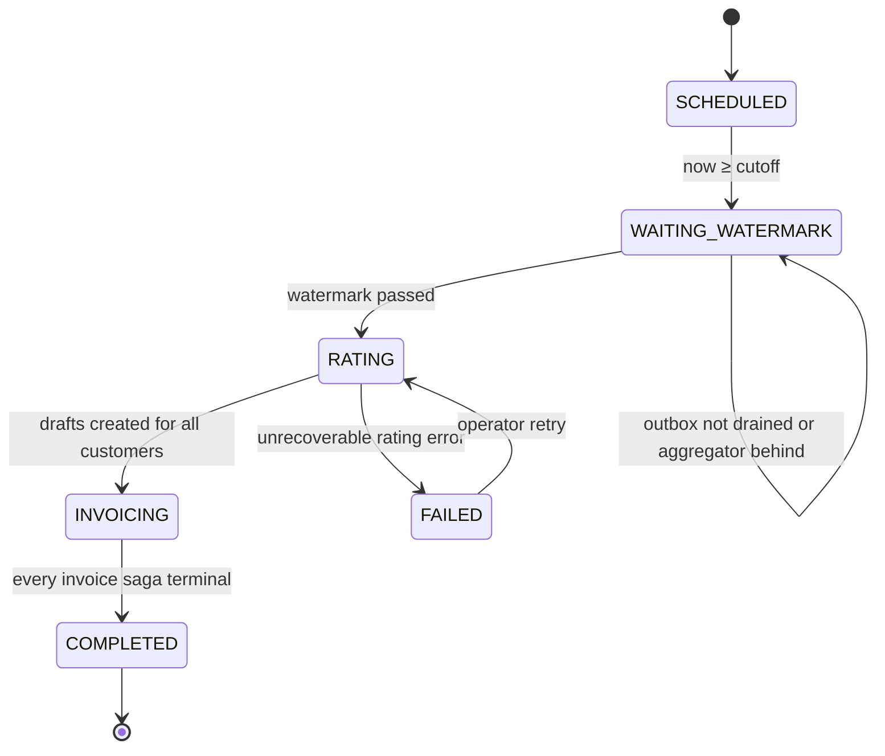
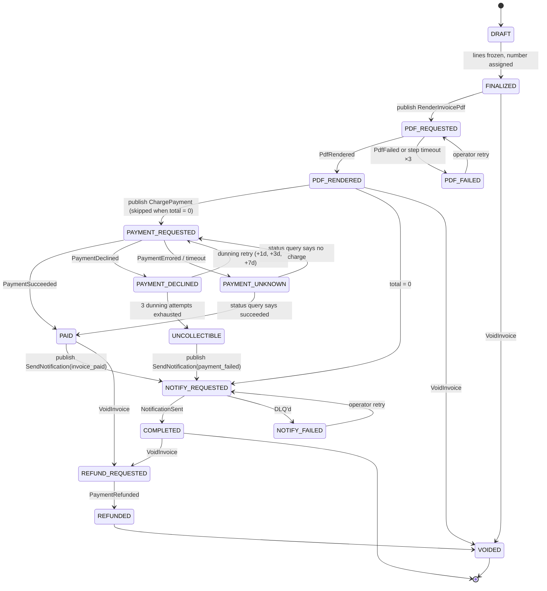

# billing-svc

## Responsibility

Turns closed usage into invoices and drives each invoice through its lifecycle:

1. **Period close.** For each tenant and month, wait until the watermark proves every on-time event is aggregated.
2. **Rating.** Apply the subscription's plan version to the usage aggregates (pure function).
3. **Invoice saga.** Orchestrate PDF rendering, payment and notification over RabbitMQ, with retries,
   timeouts and compensations ([ADR 0005](../adr/0005-orchestration-saga-for-billing.md)).
4. **Late usage and re-rating.** Bill late events as adjustment lines, and produce correction invoices after price changes.

## gRPC API (sketch)

```proto
package quotify.billing.v1;

service BillingService {
  rpc GetInvoice(GetInvoiceRequest) returns (Invoice);
  rpc ListInvoices(ListInvoicesRequest) returns (ListInvoicesResponse);       // by customer / period / status
  rpc GetInvoicePdfUrl(GetInvoicePdfUrlRequest) returns (GetInvoicePdfUrlResponse); // presigned MinIO URL, 5 min
}

service BillingAdminService {                                                // operator
  rpc ClosePeriod(ClosePeriodRequest) returns (BillingRun);                  // manual trigger, idempotent per (tenant, period)
  rpc GetBillingRun(GetBillingRunRequest) returns (BillingRun);
  rpc RetryInvoiceSaga(RetryInvoiceSagaRequest) returns (InvoiceSaga);       // from a *_FAILED state
  rpc VoidInvoice(VoidInvoiceRequest) returns (InvoiceSaga);                 // triggers compensation
  rpc StartRerating(StartReratingRequest) returns (ReratingJob);             // tenant, period, plan_version_id
  rpc GetReratingJob(GetReratingJobRequest) returns (ReratingJob);
}
```

## Period close (billing run)

One `billing_runs` row per `(tenant_id, period_id)`. A scheduler loop (every 1 min) picks tenants
whose `cutoff = period_end + grace` has passed and takes a Postgres advisory lock on
`hashtext(tenant_id || period_id)`, so one pod drives each run.



**Watermark check** starts at `cutoff + 30 s`, which is longer than ingest's 5 s `transaction_timeout`
(details in [07-correctness.md §4](../07-correctness.md#4-late-arriving-events)):

1. `ingest.GetOutboxWatermark`. Require `oldest_unpublished_ingested_at` unset or `≥ cutoff`.
   Every on-time event is now in Kafka.
2. Snapshot Kafka end offsets of `usage.events.v1` (`ListEndOffsets`). Store them in `billing_runs.required_offsets`.
3. `aggregator.GetIngestWatermark(required_offsets)` until `caught_up = true`.
   Every on-time event is now in `usage_aggregates`.

## Rating

`rating.Rate(planVersion, usage []UsageAggregate, late []LateUsage) ([]InvoiceLine, error)` is a pure function.
No I/O, table-tested, property-tested (e.g. tiered total is monotonic in quantity).

| Model | Formula |
|---|---|
| `PER_UNIT` | `round(qty × unit_price)` |
| `TIERED_GRADUATED` | `Σ_tiers round(qty_in_tier × tier_price) + tier_flat_fee` |
| `PACKAGE` | `ceil(qty / size) × package_price` |
| `FLAT` | `amount` (plan base fee) |

Prices are decimals in minor units (`"0.002"` kuruş/token). Each line is rounded half-even to an integer
minor unit **once, at line level** ([ADR 0010](../adr/0010-money-and-quantity-representation.md)).

**Late usage lines** for origin period `O`, billed on period `P`'s invoice:
`amount = rate(planVersion(O), qty_O + late_qty) − rate(planVersion(O), qty_O)`. This is the incremental cost,
so tiered prices are charged correctly. Each line is labelled "Late usage — ai_tokens — 2026-10".

## Saga state machine

One `invoice_sagas` row per invoice. Steps are classified as **compensatable**, **pivot** or **retriable**:

| Step | Command (RabbitMQ) | Class | Compensation |
|---|---|---|---|
| Create draft | — (local) | compensatable | delete draft |
| Finalize (assign number) | — (local) | compensatable | void invoice (number kept, gap-free) |
| Render PDF | `invoice.render` | compensatable | mark PDF obsolete (object kept for audit) |
| Charge payment | `payment.charge` | **pivot** | `payment.refund` (only via VoidInvoice after PAID) |
| Notify customer | `notification.send` | retriable | none (best effort, retried until success or DLQ) |



### Mechanics

- **Transitions are transactional.** Each transition is one Postgres transaction:
  `UPDATE invoice_sagas SET state=$new, version=version+1, step_deadline=… WHERE id=$id AND version=$v AND state=$expected`
  plus an `outbox` row for the next command plus a `saga_events` audit row. With 0 rows updated,
  the reply is stale or duplicate → ack and ignore.
- **Command IDs.** `command_id = uuidv5(saga_id | step | attempt)`. Workers dedup by `command_id`, and the PSP
  dedups by `idempotency_key = invoice_id + ":charge:" + dunning_attempt`.
- **Timeouts.** A sweeper every 30 s selects `state LIKE '%_REQUESTED' AND step_deadline < now()`
  (`FOR UPDATE SKIP LOCKED`) and re-issues the command with `attempt+1`, up to 3. After that it moves to `*_FAILED` / `PAYMENT_UNKNOWN`.
- **PAYMENT_UNKNOWN.** Never re-charge blindly. Publish `payment.status` (query PSP by idempotency key) first.
  This is the classic "did my timed-out charge go through?" problem.
- **Dunning** delays are days long, so they're scheduled in Postgres (`next_attempt_at`), not as RabbitMQ TTLs.
  RabbitMQ TTL retries handle **seconds to minutes** of transient failure inside a worker.

## Re-rating

`StartRerating(tenant, period, plan_version_id)`:

1. Require the period's billing run to be `COMPLETED`.
2. Re-run `rating.Rate` with the new plan version on the **same** aggregates (generation pinned in the job).
3. `delta = new_total − Σ(original invoice + previous corrections)` per customer.
4. `delta > 0` → create a `CORRECTION` invoice and run it through the normal saga.
   `delta < 0` → create a `credit_balance` entry, applied as a negative line on the next regular invoice.
   `delta = 0` → record only.
5. Idempotent per `(tenant, period, plan_version_id)` via a unique constraint on `rerating_jobs`.

Usage is never re-counted. Only prices change. Full rationale: [07-correctness.md §8](../07-correctness.md#8-replay--re-rating).

## Owned data (`billing_db`)

`billing_runs`, `invoices`, `invoice_lines`, `invoice_number_seq`, `invoice_sagas`, `saga_events`,
`credit_balances`, `rerating_jobs`, `outbox`, `inbox_replies`. See [05-data-model.md](../05-data-model.md#billing_db).

## Messages

| Direction | Channel | Message |
|---|---|---|
| out | exchange `billing.commands` | `RenderInvoicePdf`, `ChargePayment`, `RefundPayment`, `QueryPaymentStatus`, `SendNotification` |
| in | queue `billing-svc.replies` | `PdfRendered`, `PdfFailed`, `PaymentSucceeded`, `PaymentDeclined`, `PaymentErrored`, `PaymentRefunded`, `PaymentStatus`, `NotificationSent` |
| out | topic `billing.invoices.v1` | `InvoiceFinalized`, `InvoicePaid`, `InvoiceVoided` (facts, for analytics) |

## Failure modes

| Failure | Behaviour |
|---|---|
| Pod dies mid-run | Advisory lock released. Another pod resumes from the persisted state |
| Duplicate reply | Version/state guard → ignored. `inbox_replies(message_id)` dedup as a second line |
| Worker never replies | Step deadline sweeper retries, then `*_FAILED` |
| Payment timeout | `PAYMENT_UNKNOWN` → status query, never a double charge |
| Aggregator down at close | Run stays `WAITING_WATERMARK`. Alert if stuck > 1 h after cutoff |

## Scaling notes

Billing is bursty (month boundary). Runs are per-tenant and parallel across pods (advisory locks).
Customers within a run are rated in pages of 500 streamed from aggregator. **Target:** close a
10k-customer tenant in < 5 min, excluding worker latency.
