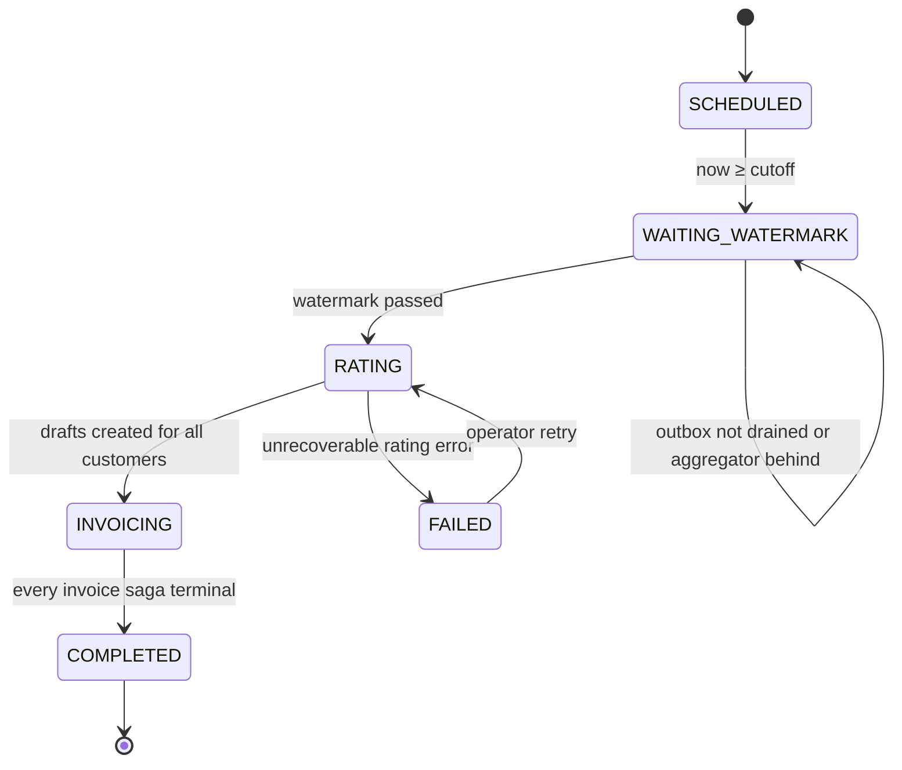
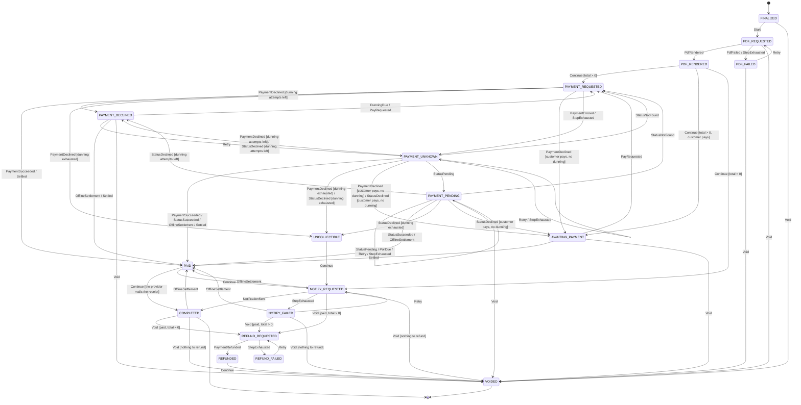

# billing-svc

## Responsibility

Turns closed usage into invoices and drives each invoice through its lifecycle:

1. **Period close.** For each tenant and month, wait until the watermark proves every on-time event is aggregated.
2. **Rating.** Apply the subscription's plan version to the usage aggregates (pure function).
3. **Invoice saga.** Orchestrate PDF rendering, payment and notification over RabbitMQ, with retries,
   timeouts and compensations ([ADR 0005](../adr/0005-orchestration-saga-for-billing.md)).
4. **Late usage and re-rating.** Bill late events as adjustment lines, and produce correction invoices after price changes.

## gRPC API (sketch)

```proto
package payrudder.billing.v1;

service BillingService {
  rpc GetInvoice(GetInvoiceRequest) returns (Invoice);
  rpc ListInvoices(ListInvoicesRequest) returns (ListInvoicesResponse);       // by customer / period / status
  rpc GetInvoicePdfUrl(GetInvoicePdfUrlRequest) returns (GetInvoicePdfUrlResponse); // presigned S3 URL, 5 min
}

service SandboxService {                                                     // sandbox tenants only (FAILED_PRECONDITION otherwise)
  rpc ClosePeriodNow(ClosePeriodNowRequest) returns (BillingRun);            // early close → normal run → normal saga
}

service BillingAdminService {                                                // operator
  rpc ClosePeriod(ClosePeriodRequest) returns (BillingRun);                  // manual trigger, idempotent per (tenant, period)
  rpc GetBillingRun(GetBillingRunRequest) returns (BillingRun);
  rpc RetryInvoiceSaga(RetryInvoiceSagaRequest) returns (InvoiceSaga);       // from a *_FAILED state
  rpc VoidInvoice(VoidInvoiceRequest) returns (InvoiceSaga);                 // triggers compensation
  rpc StartRerating(StartReratingRequest) returns (ReratingJob);             // tenant, period, plan_version_id
  rpc GetReratingJob(GetReratingJobRequest) returns (ReratingJob);
}
```

## Period close (billing run)

One `billing_runs` row per `(tenant_id, period_id)`. Periods are calendar months in the **tenant's time zone**
(`period_settings.period_end` is local midnight on the 1st, stored as a UTC instant). A scheduler loop (every 1 min) picks tenants
whose `cutoff = period_end + grace` has passed and takes a Postgres advisory lock on
`hashtext(tenant_id || period_id)`, so one pod drives each run.



**Watermark check** starts at `cutoff + 30 s`, which is longer than ingest's 5 s `transaction_timeout`
(details in [07-correctness.md §4](../07-correctness.md#4-late-arriving-events)):

1. `ingest.GetOutboxWatermark`. Require `oldest_unpublished_ingested_at` unset or `≥ cutoff`.
   Every on-time event is now in Kafka.
2. Snapshot Kafka end offsets of `usage.events.v1` (`ListEndOffsets`). Store them in `billing_runs.required_offsets`.
3. `aggregator.GetIngestWatermark(required_offsets)` until `caught_up = true`.
   Every on-time event is now in `usage_aggregates`.

## Rating

`rating.Rate(planVersion, usage []UsageAggregate, late []LateUsage) ([]InvoiceLine, error)` is a pure function.
No I/O, table-tested, property-tested (e.g. tiered total is monotonic in quantity).
Aggregates arrive as scaled integer units. Rating converts them once, `qty = units × 10^−scale` in `apd`, so fractional
meters (e.g. `1.250 GB-h`) are priced exactly. Tier boundaries (`up_to`) and package sizes are decimals in meter units.

| Model | Formula |
|---|---|
| `PER_UNIT` | `round(qty × unit_price)` |
| `TIERED_GRADUATED` | `Σ_tiers round(qty_in_tier × tier_price) + tier_flat_fee` |
| `PACKAGE` | `ceil(qty / size) × package_price` |
| `FLAT` | `amount` (plan base fee) |

Prices are decimals in minor units of the tenant's currency (`"0.002"` kuruş/token for a `TRY` tenant). Each line is rounded half-even to an integer
minor unit **once, at line level** ([ADR 0010](../adr/0010-money-and-quantity-representation.md)).

**Late usage lines** for origin period `O`, billed on period `P`'s invoice:
`amount = rate(planVersion(O), qty_O + late_qty) − rate(planVersion(O), qty_O)`. This is the incremental cost,
so tiered prices are charged correctly. Each line is labelled "Late usage — ai_tokens — 2026-10".

## Saga state machine

One `invoice_sagas` row per invoice. Steps are classified as **compensatable**, **pivot** or **retriable**:

| Step | Command (RabbitMQ) | Class | Compensation |
|---|---|---|---|
| Create draft | — (local) | compensatable | delete draft |
| Finalize (assign number) | — (local) | compensatable | void invoice (number kept, gap-free) |
| Render PDF | `invoice.render` | compensatable | mark PDF obsolete (object kept for audit) |
| Charge payment | `payment.charge` | **pivot** | `payment.refund` (only via VoidInvoice after PAID) |
| Notify customer | `notification.send` | retriable | none (best effort, retried until success or DLQ) |

<!-- saga-diagram:start -->

<!-- saga-diagram:end -->

### Mechanics

- **Transitions are transactional.** Each transition is one Postgres transaction:
  `UPDATE invoice_sagas SET state=$new, version=version+1, step_deadline=… WHERE id=$id AND version=$v AND state=$expected`
  plus an `outbox` row for the next command plus a `saga_events` audit row. With 0 rows updated,
  the reply is stale or duplicate → ack and ignore.
- **Command IDs.** `command_id = uuidv5(saga_id | step | attempt)`. Workers dedup by `command_id`, and the PSP
  dedups by `idempotency_key = invoice_id + ":charge:" + dunning_attempt`.
- **Timeouts.** A sweeper every 30 s selects `state LIKE '%_REQUESTED' AND step_deadline < now()`
  (`FOR UPDATE SKIP LOCKED`) and re-issues the command with `attempt+1`, up to 3. After that it moves to `*_FAILED` / `PAYMENT_UNKNOWN`.
- **PAYMENT_UNKNOWN.** Never re-charge blindly. Publish `payment.status` (query PSP by idempotency key) first.
  This is the classic "did my timed-out charge go through?" problem.
- **A payment that settles later** (a bank transfer, phase 29) leaves the saga in `PAYMENT_PENDING`: no command is outstanding, so there is no step deadline and nothing to retry or dead-letter. The first time it is entered the
  customer is mailed the bank details and the payment reference (`invoice_transfer.v1`); then the status is asked again every `PAYRUDDER_TRANSFER_POLL`, and at once when payments-worker nudges the saga (`RetryInvoiceSaga`) after an
  operator confirmed a receipt. The payment window is enforced by the status answer: past it the status is a decline, and the tenant's dunning delays decide whether a new window opens (a new charge, a new mail) or the invoice becomes uncollectible.
  `RecordInvoicePayment` (`OfflineSettlement`) settles an invoice with money received outside any provider, from `PAYMENT_UNKNOWN`, `PAYMENT_PENDING`, `PAYMENT_DECLINED` or after the saga gave up; the payments are rows of `invoice_payments` (who, when, method, reference).
- **Dunning** delays are days long, so they're scheduled in Postgres (`next_attempt_at`), not as RabbitMQ TTLs. A tenant may set its own delays (0 to 6 retries, 1–720 hours each; minutes in a sandbox tenant) with `PUT /v1/dunning-settings`; without a row the service-wide defaults apply, and an empty list gives up on the first decline.
  RabbitMQ TTL retries handle **seconds to minutes** of transient failure inside a worker.

### Sandbox

Sandbox tenants run the **same** close, rating and saga code. Two things differ:
- `ClosePeriodNow` calls `aggregator.ClosePeriodEarly`, then schedules the run immediately. The watermark check still runs
  (from the new cutoff + 30 s), so the flow under test is the real one.
- `ChargePayment` carries `environment = sandbox`. payments-worker routes it to mock-psp regardless of configuration
  ([ADR 0011](../adr/0011-sandbox-environment.md)). The outcome follows the customer's `pm_sandbox_*` scenario token.
- Invoice numbers use a separate prefix (`SBX-2026-000001`) so a sandbox PDF can't be mistaken for a real invoice.
  The PDF carries a "SANDBOX — not a real invoice" watermark.
- Dunning delays are compressed to +1 min / +3 min / +7 min, so a full decline → retry → uncollectible cycle fits in a demo.

## Re-rating

`StartRerating(tenant, period, plan_version_id)`:

1. Require the period's billing run to be `COMPLETED`.
2. Re-run `rating.Rate` with the new plan version on the **same** aggregates (generation pinned in the job).
3. `delta = new_total − Σ(original invoice + previous corrections)` per customer.
4. `delta > 0` → create a `CORRECTION` invoice and run it through the normal saga.
   `delta < 0` → create a `credit_balance` entry, applied as a negative line on the next regular invoice.
   `delta = 0` → record only.
5. Idempotent per `(tenant, period, plan_version_id)` via a unique constraint on `rerating_jobs`.

Usage is never re-counted. Only prices change. Full rationale: [07-correctness.md §8](../07-correctness.md#8-replay--re-rating).

**As built.**

- `plan_version_id` is the version to price *under*; the customers re-priced are those invoiced for the period whose subscription is on another
  version of the **same plan**. The job reads the tenant's *active* aggregate generation (so re-rating after a promoted replay prices the corrected usage)
  and records the generation it used.
- What a customer was billed for the period's own usage is the sum of its `BASE_FEE`, `USAGE` and earlier `CORRECTION` lines per component (the base
  fee, or a meter); late-usage and credit lines are other things. The delta is computed per component, and a `CORRECTION` invoice has one line for
  each component that changed (positive total). A customer whose total went down gets a `credit_balances` row for the difference instead.
- A correction invoice goes through `Finalize` (a number from the same gap-free sequence, a saga) exactly like a regular one. It repeats the
  snapshot of the regular invoice, so it is addressed and paid the same way.
- **Credits** are applied when the next regular invoice is drafted: oldest first, up to what the invoice costs, as a negative `CREDIT` line. A credit larger than
  the invoice is applied in parts over several invoices (`credit_applications` records each part; `credit_balances.applied_invoice_id` is set when the last of
  it is consumed). Invoice totals never go below zero.
- Idempotency is layered: the job is unique per `(tenant, period, plan version)`; a correction is unique per `(tenant, customer, job)` and a credit per
  `(tenant, customer, job)`, so a job interrupted by a crash is finished by the scheduler (`ResumeRerating`) without duplicating anything.
- Operator API: `POST /admin/v1/tenants/{tenant_id}/billing-runs/{period}/rerating` (201 on creation, 200 on a repeat), `GET .../rerating-jobs/{job_id}`;
  `payrudderctl rerate`.

## Owned data (`billing_db`)

`billing_runs`, `invoices`, `invoice_lines`, `invoice_number_seq`, `invoice_sagas`, `saga_events`,
`credit_balances`, `rerating_jobs`, `outbox`, `inbox_replies`. See [05-data-model.md](../05-data-model.md#billing_db).

## Messages

| Direction | Channel | Message |
|---|---|---|
| out | exchange `billing.commands` | `RenderInvoicePdf`, `ChargePayment`, `RefundPayment`, `QueryPaymentStatus`, `SendNotification` |
| in | queue `billing-svc.replies` | `PdfRendered`, `PdfFailed`, `PaymentSucceeded`, `PaymentDeclined`, `PaymentErrored`, `PaymentRefunded`, `PaymentStatus`, `NotificationSent` |
| out | topic `billing.invoices.v1` | `InvoiceFinalized`, `InvoicePaid`, `InvoiceVoided` (facts, for analytics) |

## Failure modes

| Failure | Behaviour |
|---|---|
| Pod dies mid-run | Advisory lock released. Another pod resumes from the persisted state |
| Duplicate reply | Version/state guard → ignored. `inbox_replies(message_id)` dedup as a second line |
| Worker never replies | Step deadline sweeper retries, then `*_FAILED` |
| Payment timeout | `PAYMENT_UNKNOWN` → status query, never a double charge |
| Aggregator down at close | Run stays `WAITING_WATERMARK`. Alert if stuck > 1 h after cutoff |

## Scaling notes

Billing is bursty (month boundary). Runs are per-tenant and parallel across pods (advisory locks).
Customers within a run are rated in pages of 500 streamed from aggregator. **Target:** close a
10k-customer tenant in < 5 min, excluding worker latency.

## As built (Phase 05)

Code: `services/billing-svc` (modules under `internal/`, see [ADR 0020](../adr/0020-modules-cqrs-errors-config.md): the saga is `sagas/{model,command}`, billing runs `billingruns/{model,query,command}`, rating `rating` and `rating/inputs`, wiring `api`), commands in `proto/payrudder/commands/v1`, the RabbitMQ
topology in `pkg/rabbitx` (exported to `deploy/rabbitmq/definitions.json`, checked by a test). Configuration:
`PAYRUDDER_SCHEDULER_INTERVAL` (1m), `PAYRUDDER_SWEEP_INTERVAL` (30s), `PAYRUDDER_STEP_TIMEOUT` (2m), `PAYRUDDER_WATERMARK_DELAY` (30s), `PAYRUDDER_TRANSFER_POLL` (6h, phase 29).
Gateway routes: `GET /v1/invoices[/{id}]`, `POST /v1/sandbox/close-period`, and the operator routes under `/admin/v1`
(`billing/close-period`, `tenants/{id}/billing-runs/{period}`, `invoices/{id}/retry|void`).

Additions to the diagram above: `REFUND_FAILED` (a refund step that timed out; `Retry` resumes it) and the transient states
`PDF_RENDERED`, `PAID`, `UNCOLLECTIBLE`, `REFUNDED`, which continue automatically in the same transaction (each hop is a
`saga_events` row). A reply from the original charge may still arrive while the status query is in flight, so
`PAYMENT_UNKNOWN` also accepts `PaymentSucceeded` and `PaymentDeclined`.

## As built: subscriptions in rating (Phase 13)

- **Currency.** An invoice is in the subscription's currency (a subscription without one is in the tenant's). The plan version is read in that
  currency: its per-currency fee and usage prices, or a permanent failure when it has none. Late usage in a different currency than the
  invoice is not billed and is logged.
- **Fixed fee.** `rating.FixedFeeLines` prices one `BASE_FEE` line per segment of the month. A subscription that was not changed has one segment
  and the plain "Base fee" line. After a plan change the chain (`changed_from_id`, oldest first) gives one segment per plan, each the fee times its
  share of the month. The first plan is in force from the start of the month, even if it began inside it.
- **Waiver.** A segment is free when its trial ends after the period, or when the subscription was paused before the period began. Usage is always billed.
- **Re-rating** skips subscriptions in another currency and those changed inside the period.

## As built: fees in advance (Phase 19)

Besides the monthly run, the scheduler calls `BillFees` on every tick. For each tenant it pages through plans-svc's `ListSubscriptionsFeeDue`; for each
due fee period it creates one `FEE` invoice (`invoices.fee_key` = `{subscription id}|{period start}`, unique per tenant) with a single `BASE_FEE` line
("Base fee (monthly|yearly) — plan — from to"), applies any credit balance, finalizes it (a gap-free number and the same payment saga as any invoice),
and then calls `AdvanceSubscriptionFee`. Every step is idempotent: a crash leaves either a draft that the next pass finds by its `fee_key` and
finalizes, or a finalized invoice whose period is advanced by the next pass. A paused subscription's period and a period whose fee is 0 are advanced
without an invoice (a resumed subscription is not charged for the weeks it was paused). The monthly run leaves the fixed fee off the invoices of
advance-billed subscriptions (`FeeSegment.Waived`), so usage alone is invoiced in arrears. `FEE` invoices are not part of any billing run.

## As built: plan changes in billing (Phase 20)

`BillFees` first asks plans-svc to `ApplyScheduledChanges` (so a downgrade's new plan has its first fee due in the same pass), then turns the **adjustments** plan changes left into money, then
invoices the fees due. An adjustment with `charge > credit` becomes a `FEE` invoice (`fee_key` = `adj|{adjustment id}`) with a `BASE_FEE` line for the new plan and a `DISCOUNT` line "Unused time on {old plan}";
`charge < credit` becomes a `credit_balances` row (`source_adjustment_id`, unique) in the subscription's currency; equal moves nothing. Then the adjustment is marked billed, so a crash in between
repeats harmlessly. A credit balance is applied to the next invoice **in its currency** (`credit_balances.currency`, set for old rows from the customer's invoices) up to what the invoice costs, as re-rating credits already were.

## As built: billing documents (Phase 22)

`CreateCreditNote` (operator; `BillingAdminService`) issues a gap-free numbered credit note (`credit_note_seq`, `CN-` / `SBX-CN-`) against a **paid** invoice, in one transaction under the invoice's row lock: the notes of an invoice never exceed it, and the amount becomes a `credit_balances` row (`source_credit_note_id`) in the invoice's currency. `GetCreditNote`/`ListCreditNotes` (newest first, paged by `created_at|id`) are tenant reads. The revenue report gains `credited_minor`.
Invoice lines can be `DISCOUNT` (a coupon, negative) or `TAX`, and carry `service_from`/`service_to`. Tax is added by `rating.TaxLine` for the customer's country from plans-svc's rates, to monthly invoices, advance fees and plan-change adjustments, but not to a subscription a provider runs; the invoice subtotal (and the PDF's) is before tax. A credit balance is applied only to invoices in its currency.


## As built: refunds, events and hosted invoices (Phase 23)

- **Credit note refunds:** `credit_notes.disposition = 'refund'` rows carry `refund_state`, `refund_attempt`, `refund_command_id`; the reply consumer matches a `RefundPayment` reply to the note by command id (`runs.SettleRefund`) before it looks for a saga; the scheduler's tick resends unanswered refunds (`SweepRefunds`).
- **Tenant events:** `tenant_event_outbox` is written in the transaction of the change (`saga.TenantEvent`) and drained to plans-svc's `RecordTenantEvent` every five seconds (`FlushTenantEvents`).
- **Dunning settings:** `dunning_settings` (per tenant), read by the saga engine when it loads a saga.
- **Hosted invoices:** `invoice_links` (token hash only); `HostedInvoiceService` has no tenant, the token is the credential, and answers one error for unknown, expired and revoked tokens.

## As built: prepaid credits (Phase 35)

Module `credits`. `credit_packs` (what a tenant sells), `credit_lots` (one per grant: `granted`, `remaining`, optional `expires_at`, `source` purchase/promo/manual, `source_ref` unique per payment) and the append-only `credit_ledger` (`grant`, `consume`, `expire`, signed `amount`, optional `idempotency_key`). A customer's credits change under `pg_advisory_xact_lock`; `ConsumeCredits` walks the spendable lots by expiry (never-expiring last), refuses with `billing.credits.insufficient` and takes nothing when they do not cover the amount, and returns the first result for a repeated key. The sweeper calls `ExpireDue` on the system pool. Details and limits: phase 35.

## As built: buying credit packs (Phase 36)

A payment link may be of kind `credit_pack` (`payment_links.pack_id`, `quantity`, `credits`, `validity_days`; the amount, currency and description are the pack's, read in the creating transaction and frozen). It is a factory like an ad-hoc link: `StartLinkPayment` makes the `LINK` invoice and a child invoice link. When that invoice's saga reaches `PAID`, `saga.linksPaid` marks the links and calls `credits.PurchasePaid` in the same transaction: `GrantPurchase` inserts the lot (`source = purchase`, `source_ref` = the invoice id, expiry = now + `validity_days`) and its ledger row, and the `credits.purchased` event is written to the outbox only when a lot was added. The unique `(tenant, source, source_ref)` makes a duplicate webhook, a replayed settlement or a retried step grant nothing; a voided or never-paid invoice never reaches `PAID`. `StartPortalPurchase` (`HostedInvoiceService`) is the portal's *Buy*: it creates (or finds, `FindOpenPortalPackLink`) the customer's credit-pack link and starts it; `GetPortal` carries the balance, lots and active packs. `credit_settings.low_threshold` (per tenant, `Get/SetCreditSettings`) makes `Consume` write `credits.low` when it takes a balance from at least the threshold to below it; `billing_app` may therefore insert into `tenant_event_outbox` (`internal/tenantevents` is the shared writer). Details: phase 36.

## As built: promotion codes on payments and credit purchases (Phase 46)

The coupon, the promotion code and the redemption ledger are plans-svc's ([plans-svc](plans-svc.md)); billing asks it. A factory link (`adhoc`, `credit_pack`) takes a promotion code in three places: the operator's `promotion_code` when the link is made (checked then against the link's own amount, claimed later), the payer's `code` field on `/i/{token}` (`QuoteLinkPromotion` shows the new total, nothing is claimed), and `StartLinkPayment` / `StartPortalPurchase` (`promotion_code`). Without a code, a coupon *waiting* for the customer (`GrantCustomerCoupon`, phase 47) is used. The price is always the link's own, frozen when it was made; the payer sends only the code.

`runs.CreateLinkInvoice` does the work in this order: a **preview** (a code that would leave nothing to pay is refused with `billing.payment_link.free_total` before it uses a redemption), then the **claim** (`RedeemPromotion`, target = the new invoice's id, so asking twice is one redemption), then the invoice: the base line, a negative `DISCOUNT` line (`Promotion code X` or `Coupon X`) and the discounted total; `invoices.coupon_code`, `promotion_code`, `promotion_target` and `bonus_credits` remember what it used. If the invoice is not made, the claim is given back. A link invoice carries no tax (the amount is what the payer pays); a subscription fee invoice takes its tax on the discounted fee, as before.

A credit pack with a bonus coupon (`bonus_percent_bps`) keeps its price; `bonus_credits` are added to the **same lot** when the invoice is paid (`creditsPurchased` reads `invoices.bonus_credits`), so they expire with the pack's credits, and `credits.purchased` carries both. A void, or credit notes that add up to the invoice, queue a row in `promotion_reversals` in the same transaction; the scheduler's `ReversePromotions` pass calls `ReversePromotion` (retried until plans-svc answers), and the code decides whether the place goes back to its count.

"First purchase only" is judged here: the customer has no paid invoice (`CustomerHasPaidInvoice`).

## As built: e-documents (Phase 30)

The `einvoices` module (`command/`, `query/`, `handler.go`) owns `einvoice_documents`. `saga.EnqueueEInvoice` creates a document and its `IssueEInvoice` command in the transaction of
`Finalize` (tenant setting `e_invoice_on = finalized`), of the saga reaching `Paid` (`paid`) and of `CreateCreditNote`; the unique `(tenant, kind, source)` makes a replay a no-op. The reply consumer applies
the worker's `EInvoiceResult` (`einvoicecmd.ApplyResult`); the existing sweeper also calls `einvoicecmd.Commands.Sweep`, which sends a retry whose backoff (1 m, 5 m, 30 m, 2 h, 12 h) has passed and a command
nobody answered in 10 minutes, and fails a document after its sixth automatic attempt. `RetryEInvoice` and `CancelEInvoice` are operator RPCs; `GetEInvoice`, `ListEInvoices` and `GetEInvoiceFileUrl`
serve the tenant (RLS). Snapshots now freeze the seller and buyer parties and `e_invoice_on` with the draft. See phase 30.

## As built: accounting (Phase 37)

Module `accounting` (`model/` for the expense and its recurrence, `command/`, `query/`, `handler.go`). The one table is `expenses` (vendor, category, `amount_minor` and `currency`, `incurred_on`, `recurring` none/monthly/yearly with an optional `recurring_until`, an optional `app_id` tag, `voided_at` and `void_reason`), under RLS. Income is not stored: `GetAccountingSummary` reads `invoices` (gross, on the day the saga reached `PAID` in `saga_events`), the `TAX` lines of `invoice_lines`, `credit_notes` and refunded sagas, and adds the expense occurrences, one block per currency, never across currencies. A recurring expense is one row, expanded when asked. Provider commission is not in the payment ledger and is shown as "not recorded" unless the tenant enters `payment_fees` expenses. The table of sources, the profit definition and the limits are in phase 37.

**Discounts (phase 46).** A discount posts as contra-revenue: `invoice_lines.coupon_code` names the coupon of a `DISCOUNT` line (migration `00032`; older lines are filled from "Coupon CODE"), `AccountingIncome` sums them per bucket (`discounts_minor`) and `AccountingCoupons` groups them per currency and coupon (invoices, gross sales before the coupon, discount, net). The summary block has `discounts_minor`, `sales_minor` (gross - tax + discounts) and `coupons`; net income and profit are unchanged because gross is already the amount paid. The CSV export has two more columns, and `GET /v1/accounting/coupons.csv` is the per-coupon report.

## As built: sandbox reset (Phase 45 E)

`SandboxResetService.ResetTenant` (operator only, environment must be SANDBOX) deletes a sandbox tenant's data in billing_db: invoices, sagas, credit notes, credits, links, runs and numbering (credit packs, credit settings and dunning settings stay). plans-svc calls it from the reset job; `internal/sandboxreset` lists what goes and `Kept` what stays on purpose, and a test fails for a table that is neither. See [ADR 0023](../adr/0023-live-and-sandbox-guards.md).
