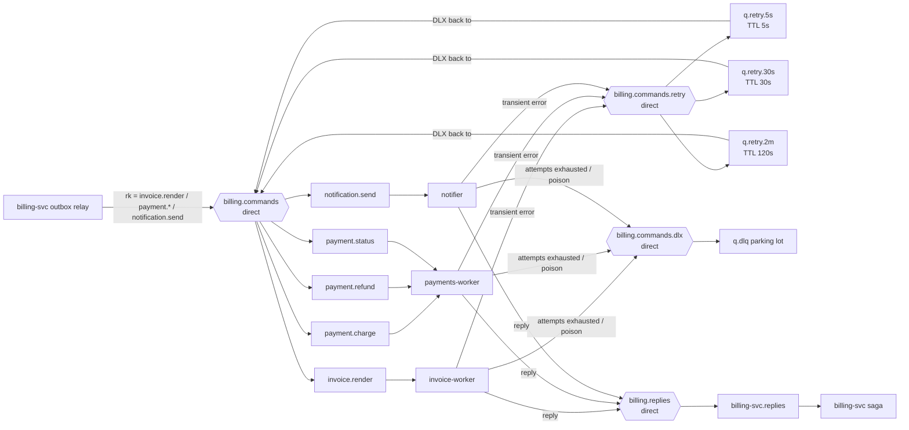

# 04 — Messaging

> **Kafka = event log (facts, replayable). RabbitMQ = task queue (commands, retries).**
> If a message describes something that *happened* and more than one consumer might care, it's a Kafka fact.
> If it asks one worker to *do* something, and might need a retry with backoff, it's a RabbitMQ command.

## Conventions

| Item | Convention |
|---|---|
| Kafka topic name | `<domain>.<entity-or-fact>.v<major>` (e.g. `usage.events.v1`). DLQ: `<domain>.<name>.dlq.v<major>` |
| Payload | Protobuf binary, messages in `proto/quotify/events/v1` ([ADR 0007](adr/0007-protobuf-event-schemas.md)) |
| Required Kafka headers | `content-type: application/x-protobuf`, `ce-type: quotify.events.v1.UsageEvent` (fully-qualified message name), `ce-id` (event id), `tenant-id`, `traceparent`, `tracestate` (W3C) |
| Producer settings | `acks=all`, idempotent producer, `linger.ms=5`, `zstd` compression, `max.in.flight=5` (safe with idempotence) |
| Consumer settings | `isolation.level=read_committed`, `auto.commit=false`, cooperative-sticky rebalancing |
| Local cluster | Redpanda single node, RF 1. Values below are the "production-like" defaults used in kind/Helm |
| RabbitMQ queues | **Quorum queues** (replicated, `x-delivery-limit` support), durable, `lazy` not needed |
| AMQP headers | `message_id` = command_id, `type` = proto message name, `traceparent`, `tracestate`, `x-attempt`, `tenant-id` |

## Kafka topics

| Topic | Key | Value | Partitions | Retention / cleanup | Producers | Consumers (group) |
|---|---|---|---|---|---|---|
| `usage.events.v1` | `tenant_id` | `UsageEvent` | 12 | `delete`, **400 days** (local: 30 d). Needed for replay | ingest-svc (outbox relay) | aggregator (`aggregator`), limits-svc (`limits`), analytics-svc (`analytics`), replay jobs (`aggregator-replay-{job}`) |
| `usage.events.dlq.v1` | `tenant_id` | original bytes | 3 | `delete`, 30 days | aggregator, analytics-svc, limits-svc | operator tooling (`quotifyctl dlq`) |
| `usage.limit-exceeded.v1` | `tenant_id` | `LimitExceeded` | 6 | `delete`, 90 days | limits-svc | analytics-svc (`analytics`), notifier (`notifier`) |
| `usage.limit-exceeded.dlq.v1` | `tenant_id` | original bytes | 1 | `delete`, 30 days | analytics-svc, notifier | operator |
| `plans.entitlements.v1` | `{tenant_id}/{customer_id}/{meter_code}` | `EntitlementState` or tombstone | 6 | **`compact`**, `min.compaction.lag.ms=1h`, `delete.retention.ms=1d` | plans-svc (outbox) | limits-svc (per-pod group, reads from earliest) |
| `billing.invoices.v1` | `tenant_id` | `InvoiceFact` (`oneof`: finalized / paid / voided / corrected) | 6 | `delete`, 400 days | billing-svc (outbox) | analytics-svc (`analytics`) |
| `billing.invoices.dlq.v1` | `tenant_id` | original bytes | 1 | `delete`, 30 days | analytics-svc | operator |

### Why `tenant_id` as the partition key

- **Locality.** A tenant's events land on one partition, so per-tenant ordering is preserved and per-tenant lag is measurable.
- **Aggregation doesn't need ordering.** `SUM`/`COUNT`/`MAX` are commutative. Ordering helps debuggability
  and keeps the late-event classification simple to reason about, but correctness doesn't depend on it.
- **Trade-off: hot partitions.** One huge tenant saturates one partition (and one consumer). Mitigations and
  the escape hatch (salted keys `tenant_id#n` for designated "whale" tenants) are in
  [07-correctness.md §7](07-correctness.md#7-noisy-neighbor). The salted key isn't built in v1.

### Event schemas (sketch)

```proto
syntax = "proto3";
package quotify.events.v1;

message UsageEvent {
  string event_id = 1;                         // ULID, assigned by ingest-svc
  string tenant_id = 2;
  string idempotency_key = 3;
  string customer_id = 4;                      // internal UUID
  string customer_external_id = 5;
  string meter_code = 6;
  reserved 7;                                  // was int64 quantity (pre-v1 draft); never reuse
  google.protobuf.Timestamp event_time = 8;
  google.protobuf.Timestamp ingested_at = 9;   // server clock, decides lateness
  map<string, string> properties = 10;
  int64 quantity_units = 11;                   // quantity × 10^quantity_scale (ADR 0010)
  uint32 quantity_scale = 12;                  // 0..6, copied from the meter
  string period_id = 13;                       // 'YYYY-MM' in the tenant's time zone, stamped at ingest
  // reserved for future: 14..19
}

message LimitExceeded {
  string event_id = 1;                         // uuidv5(tenant|customer|meter|period|threshold)
  string tenant_id = 2;
  string customer_id = 3;
  string meter_code = 4;
  string period_id = 5;                        // "2026-11"
  int32 threshold_pct = 6;
  int64 limit_units = 7;                       // scaled units (ADR 0010)
  int64 used_units = 8;
  google.protobuf.Timestamp detected_at = 9;
  uint32 quantity_scale = 10;
}

message EntitlementState {
  string tenant_id = 1; string customer_id = 2; string meter_code = 3;
  string plan_version_id = 4;
  int64 limit_units = 5;                       // scaled units; 0 = unlimited
  repeated int32 alert_thresholds_pct = 6;
  google.protobuf.Timestamp valid_from = 7;
  google.protobuf.Timestamp valid_until = 8;   // unset = open-ended
  uint32 quantity_scale = 9;
}

message InvoiceFact {
  string invoice_id = 1; string tenant_id = 2; string customer_id = 3; string period_id = 4;
  int64 version = 5;
  int64 total_minor = 6;
  oneof kind { Finalized finalized = 10; Paid paid = 11; Voided voided = 12; Corrected corrected = 13; }
}
```

## RabbitMQ topology



### Exchanges

| Exchange | Type | Purpose |
|---|---|---|
| `billing.commands` | direct | Commands from billing-svc to workers |
| `billing.commands.retry` | direct | Delayed redelivery via per-tier TTL queues |
| `billing.commands.dlx` | direct | Dead letters: exhausted retries, poison, delivery-limit exceeded |
| `billing.replies` | direct | Worker → orchestrator replies |
| `billing.replies.dlx` | direct | Undeliverable/poison replies |

### Queues

| Queue | Bound to (routing key) | Consumer | Arguments |
|---|---|---|---|
| `invoice.render` | `billing.commands` (`invoice.render`) | invoice-worker | quorum, `x-dead-letter-exchange=billing.commands.dlx`, `x-delivery-limit=5` |
| `payment.charge` | `billing.commands` (`payment.charge`) | payments-worker | same |
| `payment.refund` | `billing.commands` (`payment.refund`) | payments-worker | same |
| `payment.status` | `billing.commands` (`payment.status`) | payments-worker | same |
| `notification.send` | `billing.commands` (`notification.send`) | notifier | same |
| `{queue}.retry.5s` / `.30s` / `.2m` (×5 queues) | `billing.commands.retry` (`{queue}.retry.{tier}`) | none | `x-message-ttl` = 5000 / 30000 / 120000, `x-dead-letter-exchange=billing.commands`, `x-dead-letter-routing-key={queue}` |
| `{queue}.dlq` (×5) | `billing.commands.dlx` (`{queue}`) | operator (`quotifyctl dlq`) | quorum, no TTL |
| `billing-svc.replies` | `billing.replies` (`reply`) | billing-svc | quorum, `x-dead-letter-exchange=billing.replies.dlx`, `x-delivery-limit=5` |
| `billing-svc.replies.dlq` | `billing.replies.dlx` | operator | quorum |

Topology is declared idempotently at service start-up by `pkg/rabbitx/topology.go` (single source of truth),
and also exported as `deploy/rabbitmq/definitions.json` for inspection.

## Retry and dead-letter topology

### RabbitMQ

1. Worker classifies the error.
2. **Transient** and `x-attempt < 3` → publish a copy to `billing.commands.retry` with routing key
   `{queue}.retry.{5s|30s|2m}` (tier by attempt) and `x-attempt+1`, wait for the publisher confirm, then **ack** the original.
   Explicit re-publish instead of `nack` lets us choose the delay tier, and per-queue TTL avoids the
   head-of-line blocking that per-message TTL causes.
3. **Permanent** → reply a failure (`PdfFailed`, `PaymentDeclined`) and ack. That's business-level failure, not dead-lettering.
4. **Exhausted or poison** (undecodable, unknown `type`) → `nack(requeue=false)` → DLX → `{queue}.dlq`.
   No reply. billing-svc's step-deadline sweeper notices and moves the saga to `*_FAILED`.
5. **Crash loop** (worker panics before ack) → quorum queue `x-delivery-limit=5` dead-letters it automatically.
   This is the main reason for quorum queues over classic ones.

### Kafka

Kafka has no per-message ack, so a poison record would block its partition forever if we only retried.

1. Consumer retries a failing record **in-process** 3 times with 100 ms / 500 ms / 2 s backoff
   (covers transient DB hiccups without leaving the partition).
2. Still failing and the error is *record-specific* (decode error, validation error, unknown meter) →
   produce the original bytes to the DLQ topic with headers
   `x-dlq-reason`, `x-dlq-error`, `x-dlq-consumer`, `x-original-topic`, `x-original-partition`, `x-original-offset`, `x-dlq-at`.
   Then advance the offset (in aggregator: in the same DB transaction as the rest of the batch).
3. Error is *infrastructure* (DB down) → do **not** DLQ. Stop consuming that partition (pause) and back off.
   Lag grows, and alerts fire. DLQ-ing because a dependency is down would silently drop valid data.
4. **Redrive:** `quotifyctl dlq redrive --topic usage.events.dlq.v1 --consumer aggregator --since …`
   republishes to `usage.events.v1` with header `x-redrive-target=aggregator`. Other consumer groups skip records
   whose redrive target isn't them. The target dedups by `event_id` anyway, and the original `ingested_at` is kept,
   so late classification is unchanged.

## Message → handler matrix

| Message | Handler | Dedup key | Effect |
|---|---|---|---|
| `UsageEvent` | aggregator | `(tenant_id, event_id)` + DB-stored offsets | `usage_aggregates` / `late_usage` |
| `UsageEvent` | limits-svc | Redis-stored offset per partition | Redis counters |
| `UsageEvent` | analytics-svc | `ReplacingMergeTree` on `event_id` | `usage_events` |
| `LimitExceeded` | notifier | `event_id` | email |
| `LimitExceeded` | analytics-svc | `event_id` | `limit_events` |
| `EntitlementState` | limits-svc | key (compaction = latest wins) | in-memory map + Redis mirror |
| `InvoiceFact` | analytics-svc | `(invoice_id, version)` | `invoice_facts` |
| `RenderInvoicePdf` | invoice-worker | `command_id` + deterministic object key | PDF in S3 object storage (MinIO locally) |
| `ChargePayment` | payments-worker | `command_id` + PSP `Idempotency-Key` | charge |
| `SendNotification` | notifier | `command_id` | email |
| `*Reply` | billing-svc | saga `version`/`state` guard + `inbox_replies.message_id` | saga transition |
