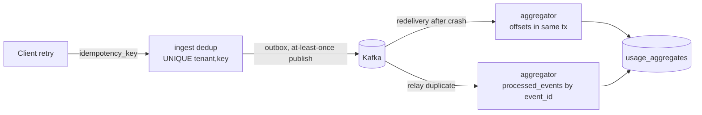
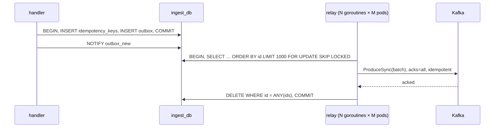

# 07 — Correctness

This is the most important document in the repo. Each section states the **problem**, the **chosen solution**,
the **trade-offs**, and the **test** that proves it.

The overall guarantee:

> Every event acknowledged with `202 accepted` is counted **exactly once** in exactly one usage aggregate
> (on-time) or late-usage row (late) of the active aggregate generation, and is billed exactly once.

The underlying transport is at-least-once everywhere. Exactly-once *effect* comes from idempotent writes
keyed on stable IDs and from storing consumer progress in the same transaction as the effect.

---

## 1. Idempotency & deduplication

**Problem.** Clients retry on timeouts and 5xx. Without dedup, a timed-out-but-committed request is counted twice.

**Solution.**
- Every event carries a client-chosen `idempotency_key`, unique per tenant.
- ingest-svc does `INSERT … ON CONFLICT (tenant_id, idempotency_key) DO NOTHING RETURNING` in the same
  transaction as the outbox insert. If the key exists, the response is `DUPLICATE` with the **original** `event_id`.
- `payload_hash` (sha256 over canonical fields) detects a reused key with a different payload →
  `REJECTED / IDEMPOTENCY_KEY_REUSED`. Silently keeping the first payload would hide client bugs.
- Dedup window ≥ 35 days (max lateness), implemented with monthly partitions ([05-data-model.md](05-data-model.md#ingest_db)).
  After the window, an old event is rejected anyway (`EVENT_TOO_OLD`), so dedup can't be bypassed by waiting.

**Downstream dedup** uses `event_id` (assigned once per key), not the idempotency key, because the event ID is the
identity of the *accepted fact*.

**Trade-offs.**
- One Postgres write per event on the hot path. Accepted: it's the durability point anyway. Redis `SETNX` would be
  faster but isn't transactional with the outbox (dual write).
- Clients that don't send a key get one generated server-side, so their retries **are not** deduplicated. Documented
  in the API reference. The key is optional only for `qk_test_` keys. Live keys require it.

**Tests.** Integration: same key ×3 concurrently → 1 outbox row, 3 responses (1 `ACCEPTED`, 2 `DUPLICATE`, same `event_id`).
Same key with different quantity → `IDEMPOTENCY_KEY_REUSED`. Month-boundary test for the partitioned window.

---

## 2. Exactly-once-like processing

**Problem.** A consumer writes to its DB and crashes before committing the Kafka offset. On restart it re-reads
the batch and applies it again. Kafka transactions (EOS) only cover Kafka-to-Kafka. Our sink is Postgres.

**Solution (aggregator): store offsets in the same DB transaction as the effect.**
1. On partition assignment, read `consumer_offsets.next_offset` from Postgres and seek there.
2. For each batch: apply effects + upsert `consumer_offsets` in **one** transaction.
3. Kafka commit is optional/advisory (lag dashboards).

Either the effect and the offset both commit or neither does, so redelivery after a crash is impossible.

**Why the `processed_events` inbox too?** Offsets protect against *Kafka redelivery*. They don't protect against
the **same event appearing twice in the log** at different offsets, which happens when the outbox relay crashes
after producing but before deleting. So aggregator also inserts `(tenant_id, event_id)` into `processed_events`
with `ON CONFLICT DO NOTHING RETURNING`, and applies only returned rows.

| Duplicate source | Caught by |
|---|---|
| Client retry | ingest idempotency key |
| Relay republish (same event, new offset) | `processed_events` |
| Consumer crash/redelivery (same offset) | offsets in DB tx (and `processed_events` as belt-and-braces) |
| Zombie consumer after rebalance | offset fencing `WHERE next_offset <= EXCLUDED.next_offset` + `processed_events` |
| DLQ redrive | `processed_events` |

**Why not Kafka transactions + idempotent producer end to end?** The sink is Postgres. EOS would only help if we
wrote aggregates back to Kafka (Kafka Streams-style), and then billing would read a compacted topic instead of
SQL. That's more moving parts and harder ad-hoc queries, for no gain at our scale. See [ADR 0009](adr/0009-transactional-outbox-and-inbox.md).

**Trade-offs.** `processed_events` is the largest table (one row per event). It's mitigated by monthly LIST partitions
dropped after 45 days. The cost is one extra index write per event.

**Tests.** Fault-injection hook `AGG_CRASH_AFTER_COMMIT=0.1` (panics after COMMIT, before Kafka commit). Run 100k events → totals exact.
Same with `RELAY_CRASH_AFTER_PRODUCE=0.1` in ingest.

---

## 3. Transactional outbox in ingest-svc

**Problem.** "Write to Postgres, then publish to Kafka" is a dual write. A crash between the two loses the event
(if we ack after DB) or makes a phantom (if we publish first).

**Solution.** The handler writes `idempotency_keys` + `outbox` in one transaction and acks the client after commit.
A relay publishes asynchronously:

**Design details.**
- `SKIP LOCKED` lets any number of relays run without leader election. Rows stay locked only while their batch is in flight.
- Delete-after-publish (not `published_at` flag) keeps the table small. The audit trail is Kafka itself.
- **Ordering:** within one relay batch, records are produced in `id` order. Across relays, two batches for the same tenant can
  interleave. Per-tenant ordering in Kafka is therefore "mostly ordered", which is fine because aggregation is commutative (see [04-messaging.md](04-messaging.md#why-tenant_id-as-the-partition-key)).
  Late classification uses `ingested_at`, not Kafka order.
- The idempotent producer removes broker-level duplicates from producer retries. Relay-crash duplicates remain, and §2 catches them.
- Latency: `LISTEN/NOTIFY` wakeup plus a 50 ms poll fallback. **Target:** p99 commit→Kafka < 200 ms.

**Alternatives considered.** Debezium/CDC on the WAL (another JVM component, heavier ops). Publishing directly to Kafka
before replying (no atomicity with dedup). Kafka-first ingest with dedup downstream (dedup window state in a
stream processor, so we'd lose the simple SQL `UNIQUE`).

**Tests.** Kafka stopped for 60 s during load → zero `202`s lost, outbox drains after restart, totals exact.

---

## 4. Late-arriving events

**Problem.** Events arrive after their period ended: buffered SDKs, batch backfills, clock skew. An invoice
can't stay open forever, and a finalized invoice must not change.

**Definitions.**
- `event_time` (tenant clock) → assigns the **period**.
- `ingested_at` (server clock, set once at ingest) → decides **lateness**.
- `cutoff(P) = end(P) + grace(tenant, P)`, where grace is snapshotted per period (default 24 h).
- **On-time** iff `ingested_at < cutoff(period(event_time))`. Otherwise **late**.

This is a pure function of the event plus snapshotted config. A replay, a redrive or a slow consumer always
reaches the same answer. The alternative ("late if the period is already closed when the consumer sees it") ties
correctness to consumer lag and makes replays non-deterministic.

**Watermark (when is it safe to close?).** We need: every on-time event is in `usage_aggregates`.

1. **Everything on time is in Kafka:** `ingest.GetOutboxWatermark` → `min(outbox.ingested_at)` is unset or `≥ cutoff`.
   Since `ingested_at` is assigned at commit time and relays only publish committed rows, no on-time event can
   still be unpublished.
   *Clock subtlety:* `ingested_at` comes from the ingest pod's clock, and pods could disagree. We use
   `now()` from **Postgres** (`clock_timestamp()` in the insert), so there is one clock per ingest DB.
2. **Everything in Kafka is aggregated:** billing-svc snapshots end offsets of `usage.events.v1`, then waits until
   aggregator's `consumer_offsets` ≥ snapshot for every partition (`GetIngestWatermark`).
3. Then billing rates the period. An event processed afterwards for period P must have `ingested_at ≥ cutoff`
   (by step 1), so aggregator puts it in `late_usage`. **Finalized aggregates of P never change.**

*In-flight transaction subtlety.* `ingested_at` is taken inside the transaction, but the row becomes visible only at
commit. A transaction that stamped `ingested_at = cutoff − 1 ms` and commits 2 s later is invisible to step 1 at
`cutoff + 1 s`. Defences:
- ingest transactions run with `SET LOCAL transaction_timeout = '5s'` (Postgres 17), so no transaction lives longer than 5 s.
- billing doesn't start the watermark check before `cutoff + 30 s`, which is longer than any ingest transaction can live.
- Defence in depth: after rating, billing calls `aggregator.FreezePeriod(tenant, P)` (sets `period_settings.frozen_at`).
  If aggregator ever sees an on-time event for a frozen period, it routes it to `late_usage` and increments
  `aggregator_frozen_period_violations_total` (page-level alert). The event is still billed exactly once, just on the next invoice.
  The cost is that it breaks replay determinism for that single event, which the alert makes visible.

**What happens to late events.**
- Stored in `late_usage` keyed by `(origin_period, billed_period = month(ingested_at))`.
- Billed on the invoice of `billed_period` as a `LATE_USAGE` line, rated with the **origin period's** plan version and
  priced incrementally (`rate(qty+late) − rate(qty)`), so tiers are honoured.
- Events older than 35 days are rejected at ingest (`EVENT_TOO_OLD`). That's the hard bound.

**Trade-offs.**
- A tenant with grace = 24 h gets invoices ~1 day after month end. Configurable from 0 to 7 days.
- Late usage arrives on a later invoice, not as a credit note on the original. That's simpler, and explainable on the line description.
- Limits ignore late events for the current period (they belong to a past period).

**Tests.** Event at `23:59:59Z` on the last day, ingested at `end + 23h` → on-time. Same event at `end + 25h` → late, on the
next invoice. Replay of the period reproduces identical classification. Watermark: block the relay during close →
billing stays `WAITING_WATERMARK` until the outbox drains.

---

## 5. Limit enforcement consistency across pods

**Problem.** Many pods consume usage. Limits need a near-real-time view. A distributed lock per event is too slow,
and in-memory counters per pod are wrong as soon as there are two pods.

**Solution.**
- **Ownership:** a Kafka partition has exactly one consumer in group `limits`, so a given tenant's counters are
  updated by one pod at a time (tenant → partition → pod).
- **Atomicity:** each batch is one Redis Lua script: offset guard + `INCRBY` for every key + offset update. A
  redelivered batch (`first_offset < stored offset`) is skipped.
- **Threshold events:** fired once using `SET NX` on a `fired` key, with a deterministic `event_id` for consumer-side dedup.
- **Reconciliation:** every 5 min, compare Redis with aggregator at the **same offset prefix** of each partition (snapshot
  checkpoint protocol in [limits-svc.md](03-services/limits-svc.md#reconciliation)) and correct drift.

**Consistency stated explicitly** ([ADR 0006](adr/0006-eventual-consistency-for-limits.md)):
- `CheckEntitlement` is **eventually consistent**. Staleness = consumer lag (target p99 < 2 s) and is returned as `as_of`.
- A customer can overshoot a limit by up to (their ingest rate × staleness). Tenants that need hard caps should enforce with a
  safety margin. That's acceptable because limits gate *service*, not billing. Billing uses aggregator.
- Counters can drift upward (relay duplicates) or reset (Redis loss). Both are corrected by reconciliation, bounded by
  the reconciliation interval.

**Rejected alternative.** A synchronous `CheckAndIncrement` on the ingest path. It's linearizable, but couples ingest
availability to Redis and puts a cross-service call on every event. Revisit if a "prepaid hard stop" feature arrives.

**Tests.** Two limits-svc pods with forced rebalances during load → after the final reconciliation, every counter == aggregator total.
Threshold crossed exactly once per (key, threshold) across rebalances (consumer-side dedup count).

---

## 6. Invoice saga

**Problem.** Invoicing spans billing state, a PDF store, a payment provider and email, with no distributed transaction.
Any step can fail, time out, or be delivered twice.

**Solution.** Orchestration-based saga in billing-svc ([ADR 0005](adr/0005-orchestration-saga-for-billing.md)).
State machine, step classes (compensatable → **pivot** = charge → retriable) and transitions are in
[billing-svc.md](03-services/billing-svc.md#saga-state-machine). Key rules:

1. **Persist, then send.** A transition and its next command commit together (saga row + outbox row).
2. **Guarded transitions.** `UPDATE … WHERE version = $v AND state = $expected`. Duplicate or stale replies are no-ops.
3. **Deterministic command IDs** `uuidv5(saga|step|attempt)`. Workers dedup on them.
4. **Timeouts are first-class.** Every `*_REQUESTED` state has a `step_deadline`. The sweeper retries ×3, then fails the step.
5. **Ambiguous payment outcome** → `PAYMENT_UNKNOWN` → status query by idempotency key. Never charge twice.
6. **Compensation only before the pivot,** plus refund via an explicit `VoidInvoice` after it. Steps after the pivot (notify)
   are retried forward, never compensated.
7. **Human in the loop.** `*_FAILED` states are terminal until an operator calls `RetryInvoiceSaga`. Every transition is in `saga_events`.

**Failure matrix.**

| Failure | Result |
|---|---|
| billing-svc crash after transition commit | Outbox relay sends the command after restart |
| Worker crash after side effect, before reply | Redelivery → worker inbox returns stored reply |
| PSP charged, response lost | `PAYMENT_UNKNOWN` → `payment.status` → `PAID` |
| PDF renderer keeps failing | `PDF_FAILED`. Payment not attempted |
| Card declined | Dunning +1d/+3d/+7d → `UNCOLLECTIBLE` → notify |
| Reply delivered twice | Version guard + `inbox_replies` |

**Tests.** Table-driven state machine unit tests (every `(state, reply) → state`), plus property test: random reply
sequences including duplicates and reorders never yield a double charge in mock-psp. Integration with mock-psp
fault rates (decline, error, timeout-after-commit).

---

## 7. Noisy neighbor

**Problem.** One tenant's spike degrades everyone: gateway CPU, ingest DB, a hot Kafka partition, consumer lag.

**Layers of defence.**

| Layer | Mechanism |
|---|---|
| Admission | GCRA per tenant per rate class at gateway, charged **per event**. `429` + `Retry-After` |
| Request size | Batch ≤ 500 events / 1 MiB |
| Ingest DB | Outbox depth back-pressure (`RESOURCE_EXHAUSTED` when > 5M rows). Per-tenant outbox depth metric |
| Kafka | `tenant_id` key → a hot tenant saturates **one** partition. Other tenants on that partition share its lag |
| Consumers | Per-partition, per-tenant lag metrics (`consumer_lag_seconds{tenant}` computed from `ingested_at` of last applied record vs now) |
| Billing | Runs per tenant in parallel. A huge tenant can't block another tenant's close |

**Partitioning trade-off.** With 12 partitions and hashing, roughly 1/12 of tenants share a partition with the hottest tenant.
Options, in order of escalation:
1. **(v1)** Rate limits keep any tenant below one partition's throughput (≈ 10k events/s **target** for one aggregator consumer).
2. **(documented, not built)** Salted key `tenant_id#{n}` for designated "whale" tenants, spreading them across `n` partitions.
   Safe because aggregation is commutative and late classification doesn't depend on order. Cost: per-tenant order is lost and the tenant's lag must be summed over partitions.
3. **(documented)** Dedicated topic/consumer group for enterprise tenants.

**Tests.** k6 scenario: tenant A at 10× quota, tenants B–J at normal rate → A receives `429`s, B–J ingest p99 within 20% of the
baseline (**target**, Phase 9).

---

## 8. Replay / re-rating

Two different operations, deliberately separated:

| | Re-rating | Re-aggregation (replay) |
|---|---|---|
| Trigger | Price change for a closed period (e.g. a negotiated discount, a pricing bug) | Meter definition bug, aggregator bug, data corruption |
| Input | Existing usage aggregates (pinned generation) | Raw events from `usage.events.v1` (retention 400 d) |
| Touches usage? | **No** | Builds a **new generation** next to the old |
| Output | Correction invoice or credit | New aggregates. Optionally followed by re-rating |
| Owner | billing-svc `StartRerating` | aggregator `StartReplay` |

**Re-rating safety.** Rating is a pure function of (plan version, aggregates). The job pins the generation, computes
`delta = new − already_billed`, and is unique per `(tenant, period, plan_version)`, so running it twice changes nothing.
Usage is never re-counted.

**Replay safety (generations).**
1. `StartReplay(tenant?, from, to)` creates generation `N+1` with status `building` and a consumer group `aggregator-replay-{job}`.
2. Start offsets: `ListOffsetsAfterMilli(start_of(from) − 35 days)` (the earliest `ingested_at` that can belong to `from`, given max lateness).
   End offsets: the end-offset snapshot at job start.
3. The replay consumer applies the **same code path** as live aggregation into generation `N+1`, with its own `processed_events`
   rows (the `generation` column) and its own `consumer_offsets` group. Live aggregation continues on generation `N`.
   Records outside `[from, to]` or of other tenants are skipped.
4. After the end offsets are reached → `verifying`: diff report N vs N+1 per (customer, meter, period), stored in the job.
5. `PromoteGeneration` (operator) atomically flips `active`, after which live consumption writes to N+1 as well. *Catch-up subtlety:* events
   that arrived after the end-offset snapshot exist in N only. Promotion therefore first runs the replay consumer up to the
   **current** live offsets with live consumption paused (seconds), then flips.
6. Billing runs pin the generation they used. A re-rating job on a promoted generation produces the correction invoices.

**Tests.** Seed period with known totals, then introduce a "bug" (meter filter) → replay → promoted generation equals the corrected expectation.
Re-rating twice → one correction invoice.

---

## 9. Schema evolution of events

**Problem.** Producers and consumers deploy independently, and replay reads events written by old producer versions
(up to 400 days old).

**Rules** (enforced by `buf breaking --against '.git#branch=main'` in CI, category `WIRE_JSON`):
- Never change a field's number or type. Never reuse a number. Removed fields become `reserved` (number **and** name).
- New fields are optional by nature (proto3 defaults). Consumers must treat the zero value as "absent".
  Use `optional` when zero is meaningful.
- Enums: first value `*_UNSPECIFIED = 0`. Consumers handle unknown enum values (proto3 open enums) as "unknown", never panic.
- Renames are allowed by wire rules, but **we disallow them** (JSON and logs would break). `buf` lint `FIELD_NO_DELETE` plus review.
- A semantic change (e.g. quantity unit) is a **new major version**: `quotify.events.v2.UsageEvent` on topic `usage.events.v2`.
  The producer dual-writes during migration. Consumers move over, then v1 is retired after the retention window.
- Every Kafka record carries `ce-type` with the fully qualified message name, so consumers can route multiple types or versions.

**Compatibility direction.** Backward **and** forward compatible within a major version: new consumers read old events
(replay), and old consumers read new events (rolling deploys).

**Schema registry?** Not in v1. `buf` + monorepo + CI gives compile-time guarantees without a runtime dependency.
Redpanda's built-in registry is an open question for when external producers exist.

**Tests.** Golden fixtures: binary `UsageEvent`s serialized by each released version, stored in `proto/testdata/`, and
decoded by current consumers in CI.

---

## 10. Poison messages

**Problem.** A message that always fails blocks a Kafka partition forever, or loops forever in RabbitMQ.

**Kafka (aggregator, analytics, limits, notifier).**
- Distinguish **record errors** (decode failure, unknown `ce-type`, validation) from **infrastructure errors** (DB/Redis down).
- Record error → 3 in-process retries → produce to `*.dlq.v1` with diagnostic headers → advance the offset (in aggregator,
  inside the same DB transaction, so "DLQ'd" and "offset advanced" are atomic, or as close as possible: DLQ produce first,
  then commit. A crash between them re-DLQs the record, and the DLQ consumer dedups by `x-original-partition/offset`).
- Infrastructure error → **never DLQ**. Pause the partition, back off, alert on lag.
- Redrive with `x-redrive-target` ([04-messaging.md](04-messaging.md#kafka)).

**RabbitMQ (workers, billing replies).**
- Transient → TTL retry tiers 5 s / 30 s / 2 min → `{queue}.dlq` after 3.
- Undecodable → `nack(requeue=false)` → DLX immediately.
- Crash loop → quorum queue `x-delivery-limit=5` → DLX.
- DLQ'd command → no reply → saga step deadline → `*_FAILED` → visible to the operator, retryable.

**Operations.** `quotifyctl dlq ls|show|redrive|purge` for both brokers. Alert when DLQ depth > 0 for 5 min
(`dlq_messages{queue}`). A DLQ is an inbox for humans, so it must not fill up silently.

**Tests.** Inject a malformed record mid-batch → it lands in the DLQ with correct headers, all other records aggregate, partition
lag returns to 0. Worker panic on a specific `command_id` → message in DLQ after 5 deliveries, saga `PDF_FAILED`.
