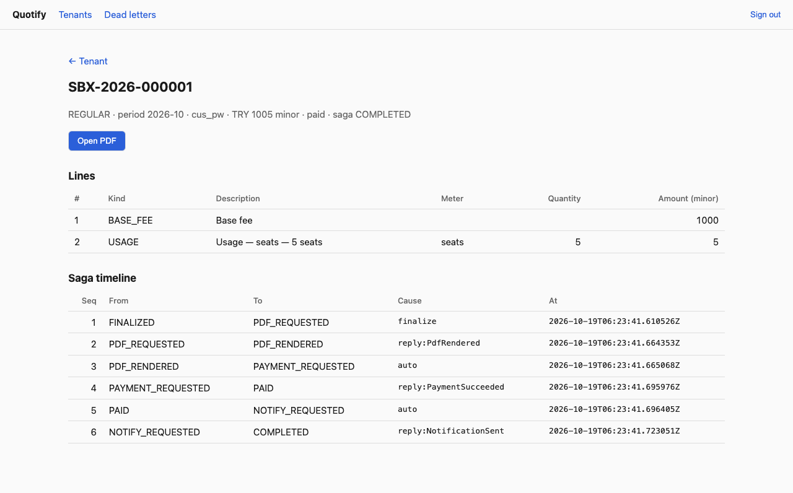
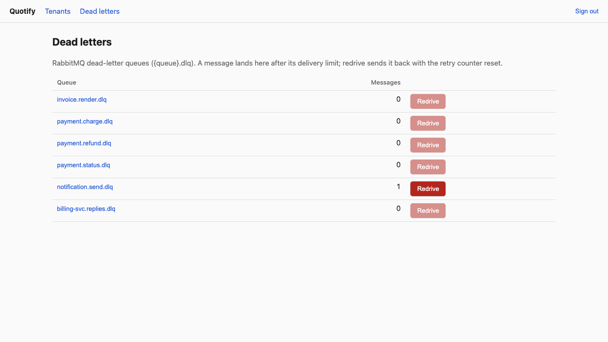

# Operator console

`web/admin` is a small Vue 3 and TypeScript console (Vite, TanStack Router, TanStack Query, vue-i18n) for an operator: it makes the state of the system visible during a demo and
offers the two actions an operator needs most, redriving dead letters and reading a saga. It is served by the Compose `app` profile at
<http://localhost:42301> and talks to **the gateway only**: no database, broker or service port.

| View | What it shows |
|---|---|
| Sign-in | None of its own. An operator is a **person** who signs in on the one sign-in page ([below](#sign-in-methods)) with an address listed in `QUOTIFY_OPERATOR_EMAILS` and has verified it; the console is then at `/operator`, a door in the side bar that only operators see. |
| Tenants | Every tenant: environment, tier, currency, time zone. |
| Tenant | A header and its tabs. **Overview**: its invoices (kind, period, total, status, saga state) and a lookup for replay and re-rating jobs by id. The other tabs are the billing pages below. |
| Customers | List and create (customer id, name, e-mail, country, billing currency). |
| Packages | Packages with their latest version's fixed fee and fees in other currencies; publish a version (amounts typed in major units, sent as minor units; a package that exists gets a new version). |
| Subscriptions | List, create (customer, package, currency, trial days, provider or "by the routing rules"), and a panel to pause, resume, cancel at the period end, end now, change package and **move to another payment provider** (a subscription a provider runs is only moved), with the customer's **usage against the package's limits** this period. |
| Payments | The payment ledger across providers, and a **reconciliation** of a period's paid invoices against it. |
| Apps | The apps of the tenant's account, each with its sandbox and live tenant; create an app (name, optional slug, currency, time zone, grace period); per environment **create an API key** (the secret is shown once) and **revoke** keys (the API cannot list keys, so those made in the visit are listed, any key can be revoked by id). Rename and delete need operator routes that do not exist yet. |
| Seller address | The address printed as the seller on every invoice: country first, then the fields that country asks for, the backend's validation, and a **preview** of the seller block as the invoice prints it. |
| Providers | The tenant's provider accounts (credentials are sealed and never shown again), the **routing rules** with a preview, and the subscriptions the providers run. |
| Reports | Revenue by period, provider and country; subscriptions and monthly recurring revenue; unpaid invoices. A row per currency, never one total. |
| Invoice | Lines, a link to the PDF (presigned for five minutes) and the **saga timeline**: every transition with its cause and time, from `saga_events`. |
| Playground | The guided sandbox walk-through described below. |
| Dead letters | The depth of every RabbitMQ `*.dlq`, a peek at one queue's messages, and **Redrive** (with a confirmation) which moves them back with the retry counter reset. |





## Sign-in methods

There are exactly three ways to sign in, all on `/signin` (and the same three on `/signup`), and nothing else: **e-mail and password**, **a one-time code** mailed to the address (passwordless; for an address without an account the code creates one), and **Google** ("Continue with Google", shown only when the deployment has set it up; `GET /auth/methods` tells the page which are on). The design, the threat model and the tests are in [phase 42](phases/phase-42-signin-methods.md).

**Operators.** `QUOTIFY_OPERATOR_EMAILS` (a comma list on the gateway; empty by default, so nobody is an operator; the dev stack lists `user1@example.com`, the dev seed's first user) names the people who are platform operators. The gateway decides **on every request**, from the session: the user's address is on the list **and verified**. A client claim is never read (a header, a body field or the browser's own storage opens nothing), the flag is not stored on the user, and a session of anybody else is `403 identity.operator.forbidden`. The page learns the verdict from the sign-in answer and `/auth/me` (`operator: true|false`) and only uses it to show the side-bar door and the console's pages. `QUOTIFY_OPERATOR_TOKEN` is **no longer a sign-in**: it stays as the machine credential of the API, `quotifyctl`, the demo, the playground's server side and the tests, and no page asks for it or serves it.

**Setting up Google** (real Google was not exercised by the tests, which use the in-repo stand-in; follow these steps once and try it):

1. In the [Google Cloud console](https://console.cloud.google.com/) create or pick a project, then *APIs & Services → OAuth consent screen*: user type External (or Internal for a Workspace), app name, support e-mail, the scopes `openid`, `email` and `profile` (all non-sensitive, so no verification review is needed), and add yourself as a test user while the app is in *Testing*.
2. *APIs & Services → Credentials → Create credentials → OAuth client ID*, application type **Web application**.
3. **Authorized redirect URIs**: the console's public address plus `/gw/auth/google/callback`, exactly, scheme and port included. The console forwards `/gw/*` to the gateway, so the browser, the cookie and the callback all stay on one origin. Locally: `http://localhost:42301/gw/auth/google/callback` (Google accepts `http://localhost` for development). In production: `https://app.example.com/gw/auth/google/callback`. If the gateway is reached at another address, set `QUOTIFY_GOOGLE_REDIRECT_URL` to that callback URL and register that. *Authorized JavaScript origins* can stay empty: the flow is entirely server side.
4. Copy the **client ID** and **client secret** into `QUOTIFY_GOOGLE_CLIENT_ID` and `QUOTIFY_GOOGLE_CLIENT_SECRET` on the gateway (the secret is an environment variable only: never YAML, never logged), set `QUOTIFY_APP_URL` to the console's public address, restart the gateway. The button appears; `GET /auth/methods` says `"google": true`.

**Trying the flow without Google.** `docker compose -f deploy/compose/compose.yaml --profile oidc up -d mockoidc`, then start the gateway with `QUOTIFY_GOOGLE_CLIENT_ID=mock-client-id QUOTIFY_GOOGLE_CLIENT_SECRET=mock-client-secret QUOTIFY_GOOGLE_ISSUER=http://mockoidc:8099` (for `make dev`, issuer `http://localhost:42899`). "Continue with Google" then opens a page at <http://localhost:42899> where you type any address; it is a stand-in, never to be exposed.

## Playground

`/playground` (an operator page) is a guided walk through the product: create a sandbox account (currency, time zone and grace period are required, nothing is
preselected), create a meter, a plan with a base fee and a per-call price, a customer and a subscription, choose the mock payment outcome, send usage, close the period, and watch the
invoice go through its saga (with a link to the full timeline). It calls the same public API a customer would, with the sandbox tenant's own `qk_test_` key, so it exercises the real system end
to end; it never touches a live tenant. A declined payment leaves the invoice open in `PAYMENT_DECLINED` while dunning retries it. Playwright runs both the paid and the declined path.

## The billing tabs

They show a tenant's data through the tenant API the tenant itself uses, with the operator's session plus `X-Quotify-Tenant: <tenant id>` ("act as", gateway `authenticate`; the machine token acts the same way): the
same endpoints, rate limits and validation, no operator-only copy. Provider accounts, the ledger, the reconciliation and provider moves are operator routes and go as the operator.
The pages are the features `customers`, `packages`, `subscriptions`, `payments`, `providers`, `reports`, `webhooks`, `apps` and `seller-address`; the tenant layout (`features/tenants`) hosts them as child routes.
Their tests (`e2e-mock/`, `npm run e2e:mock`) run the built console against a **mocked gateway** (every `/gw` request is answered by the test), so they need no stack and run in the console's CI
job; `e2e/` still drives the real stack.

## How it is built

- **Feature-based layout.** `src/features/<feature>` owns everything about one part of the product: its pages (`*.vue`), its TanStack Query hooks (`api.ts`), its route
  declarations (`routes.ts`) and a small public `index.ts`. The features are `auth`, `tenants`, `invoices`, `dead-letters`, `playground`, `customers`, `packages`, `subscriptions`, `payments`, `providers`, `reports`, `webhooks`, `apps` and `seller-address`; `src/app` only composes them (router, query client,
  i18n, layout) and `src/shared` holds what several features need (the API client, the session token, money and label helpers). A feature imports another only through its `index.ts`
  (the tenant page shows `invoices`' table).
- **TanStack Router** (`@tanstack/vue-router`, code-based routes). Every feature exports a function that creates its routes under a parent; the app mounts all but the sign-in page under one
  pathless route whose `beforeLoad` redirects a visitor to the sign-in page and a person who is not an operator to their home (the server decides again on every request). The router is not registered for global type inference: registering it makes pages and the route tree
  depend on each other's types, a cycle TypeScript reports as an implicit `any`, so route paths are plain strings and the Playwright tests are what catches a wrong one.
- **TanStack Query** (`@tanstack/vue-query`) for every read and write. `unwrap()` turns an `openapi-fetch` result into data or an `ApiError` (the gateway's code and message), which is what a query function
  must throw; queries are keyed per tenant and invoice, a refused token or a missing resource is not retried, and the playground's invoice list polls while the saga runs.
- **Languages.** `vue-i18n` with six locales (English, Türkçe, Deutsch, Español, Français and العربية, which switches the page to right-to-left): `src/locales/*.json`. The language is the
  saved choice, else the browser's first supported language, else English; the switcher in the navigation changes `lang`, `dir` and the title, and remembers the choice. Backend enum values
  (invoice status and kind, environment, tier) are translated when the locale has a label and shown as they are when it does not, so a new backend value still appears. Amounts are
  formatted from minor units with the currency's exponent and the locale (`shared/lib/money.ts`; the digits are moved as text, never through a float). A unit test fails if a locale misses a key
  or changes a `{placeholder}`. Technical identifiers (saga states, ids, causes) are not translated.
- **Error keys.** The API sends a stable `error.key` ([error-keys.md](error-keys.md), [ADR 0020](adr/0020-modules-cqrs-errors-config.md)) with an English message. Every page shows an error through one function, `errorText` / `useErrorText()` in `shared/lib/errors.ts`: the message is `errors.<key>` in the locale file (nested, `errors.billing.credit_note.not_paid`) with the first error detail as `{field}` and `{detail}`, and the server's message when the locale has no entry, so a key newer than the console still shows something. A unit test reads `docs/error-keys.md` and the `common.*` defaults of `pkg/errkey` and fails when any of the six languages lacks a key (or keeps one the backend dropped). Adding an error in Go therefore means: regenerate the doc, add the six translations.

- **Typed client.** `npm run gen` generates `src/lib/schema.d.ts` from [`api/openapi/v1.yaml`](../api/openapi/v1.yaml) with `openapi-typescript`;
  the client is `openapi-fetch` over those types, so a route or field that does not exist in the spec does not compile. CI regenerates the file and fails on a
  diff, and the ESLint config forbids `any`. The gateway does not serve the spec: the file in the repository is the source.
- **Same origin.** The browser calls `/gw/...`; nginx in the image (Vite's dev server in development) forwards it to `GATEWAY_URL` with the `Authorization` header and resolves the
  gateway on every request, so a recreated gateway is found again. The gateway needs no CORS configuration.
- **Operator routes added for it** (all behind operator access: the machine token or an operator's session, in the OpenAPI file): `GET /admin/v1/tenants`, `GET /admin/v1/tenants/{tenant_id}/invoices[/{invoice_id}[/pdf|/saga]]`,
  `GET /admin/v1/dead-letters`, `POST /admin/v1/dead-letters/redrive`. The tenant-scoped reads run the billing call in the tenant named in the path; the dead-letter
  and saga operations are `BillingAdminService` RPCs (billing-svc owns the saga log and the RabbitMQ topology).
- **Scope kept small on purpose.** Read-only views plus the redrive. The Kafka dead-letter topics are `quotifyctl dlq --broker kafka`; starting a replay or a re-rating is the
  admin API or `quotifyctl`, the console only looks jobs up. Who may open it is decided by the gateway from the session (see [Sign-in methods](#sign-in-methods)); people use the product app instead.

## UI kit

Styling is Tailwind CSS 4 (`@tailwindcss/vite`, no config file; tokens live in `@theme` in `src/app/styles.css`, dark mode follows `prefers-color-scheme`).
`src/shared/ui/` holds [shadcn-vue](https://www.shadcn-vue.com) components (new-york style, built on reka-ui, `cva`, `tailwind-merge` and `@lucide/vue` icons):
button, input, textarea, label, checkbox, switch, select, dialog, dropdown-menu, tabs, tooltip, table, card, badge, alert, separator, skeleton and sonner (toasts).
They are copied into the repository, not imported from a package, so they are ours to edit. `components.json` points the shadcn-vue CLI at this layout:

```sh
cd web/admin && npx shadcn-vue@latest add popover   # drops the component into src/shared/ui/popover
```

Check what the CLI changed afterwards: it adds dependencies with `^` ranges (pin them) and may guess the `cn` import wrongly (it must be `@/shared/lib/utils`).
The console is one light theme (soft grey canvas, white cards, dark green actions, lime highlights); there is no dark mode. Every page is built from the kit.

`make dev` runs the Go services on your machine (against the infrastructure containers that `make setup` started) and the Vite dev server on port 3001, both with reload; `make dev-docker` runs the services in Docker instead, and `make logs` (or `make logs S=gateway`) follows their logs.

In development the playground account form comes pre-filled: the Vite dev server does it by default, the compose stack through
`PREFILL_PLAYGROUND=true` (served as `/env.js`). Leave it `false` anywhere that is not a throwaway local stack. No credential is ever served to the browser.

## Tests

`web/admin/e2e/smoke.spec.ts` (Playwright, run by CI's end-to-end job against the Compose stack, `make web-e2e` locally) creates a sandbox account, closes a period and waits for
a paid invoice, then drives the browser: open the console as the operator user (a session from the real sign-in routes: the dev seed's `user1@example.com` with its password, else a one-time code read from Mailpit; the dev stack lists that address in `QUOTIFY_OPERATOR_EMAILS`), open the tenant and the invoice, and check that the saga timeline has at least five transitions ending in
`COMPLETED`; a signed-out visitor is sent to the sign-in page (which has no token form, and the machine token is no password), a person who is not an operator gets 403 from the API and is sent home by the page; a valid notification command put into `notification.send.dlq` appears in the dead-letter view
and disappears when redriven (the notifier delivers it; the saga it names is already final, so its reply is ignored).

`make web-check` runs install, ESLint, the type check (`vue-tsc`), the unit tests (Vitest: locale parity, error-key coverage, address rules and money formatting), the OpenAPI type check and the build.
`web/admin/e2e/i18n.spec.ts` checks that the language follows the browser, can be changed and remembered, that Arabic is right-to-left, and that the signed-in pages and the playground are translated.

## Not covered

The console is not part of the Helm charts (reach it with `kubectl port-forward` of a locally built image, or run `npm run dev`); on Kubernetes the gateway's `/admin` routes are
the same ones and can be blocked from outside the namespace by a NetworkPolicy.

## The product app and the shared look (Phase 38)

The same Vite app now has two audiences. **People** sign up and sign in at `/` and `/signup` and work under `/app` (organisation home, app dashboard with a sandbox/live switch, API keys shown once, settings); their session token (`qs_…`) is kept in `sessionStorage`. **The operator** keeps the token page, now at `/operator`, and everything under `/tenants`, `/playground` and `/dead-letters`. Both share one set of design tokens (`src/app/styles.css`), the dark icon rail and the card, badge, button and input primitives, with light and dark themes. A person reaches a tenant's customers, payment links, credits and webhooks through the same feature pages the operator uses, mounted under `/app/t/{tenant}`. Details, routes and the security stance: [phase 38](phases/phase-38-product-app.md).

Phase 39 adds the pages the mails open and the account flows around them: `/forgot`, `/reset#token=…` and `/verify#token=…` (the token is read from the URL fragment once and removed from the address bar), the "confirm your e-mail address" banner with a resend button on every signed-in page, and a live-key button that explains why it is disabled until the address is confirmed. The settings page now manages the team (invite by e-mail, open invitations with resend and cancel, role changes, remove or leave with a confirmation, rename the account), `/invite#token=…` is the page an invitation opens, and a person with several accounts has an account switcher. See [phase 39](phases/phase-39-product-app-complete.md).

The tab bar of an environment (`/app/t/{tenant}`) now also has Invoices (list with status filter, invoice with lines and PDF), Payments (the folded ledger from `GET /v1/payments`), Packages, Pricing and Reports. They speak the tenant API only; the console's invoice and payments pages (saga, transfers, raw ledger, reconciliation) remain operator pages, and a test fails if a page mounted in the app mentions an `/admin/v1` route. A viewer sees the pages read-only.

## The frame, privacy mode and the pickers (Phase 41)

Every signed-in page (the person's under `/app`, the operator's under `/tenants`) sits in one frame, drawn from one description of the navigation (`src/app/layout/nav.ts`).

- **Sidebar.** Open by default on a wide screen (1024 px and up): icons and labels, grouped in sections. It folds to an icon rail (labels stay for screen readers and as tooltips); the choice is kept in `localStorage` (`quotify.sidebar.collapsed`), guarded by `try`/`catch` so a browser that blocks storage still gets the open sidebar. Below 1024 px it is a drawer from the start edge (the right in Arabic): a modal dialog, focus moves in, stays in, Escape closes it and focus returns to the menu button.
- **It follows the route.** Four levels: the **organisation** (apps, members, settings), an **app** (dashboard, customers, subscriptions, credits, packages, pricing and tax, invoices, payments, payment links, accounting, reports, API keys, webhooks, app settings, e-mail), the operator's **platform** (tenants, playground, dead letters) and one **tenant** for the operator (the app pages plus providers, e-invoice, seller address, apps and API keys). The active item carries `aria-current="page"`; the breadcrumbs (organisation, app, page) come from the same data. A page is in the sidebar only when its route exists (`PERSON_PAGES`), so the navigation never leads to "not found".
- **Header.** Breadcrumbs, the **app switcher** and the **environment switcher** (live and sandbox keep you on the same page of the other environment), the **privacy switch**, language menu, theme and the person's menu. On a phone the switchers wrap to a second line.
- **Privacy mode** (eye button, or Alt+P). While it is on, every amount is replaced by `••••` (the currency stays) and customer e-mail addresses by `a•••@domain`. It is done in `formatMinor`, the one function every amount goes through, so the figures are not in the page at all (not hidden by a style): they are not in a screenshot, in the print preview or in what a screen reader says. Remembered per browser (`quotify.privacy`), kept across navigation and reload, and followed by other tabs through the `storage` event. CSV exports are not masked: they are a deliberate download.
- **Pickers.** Currency and time zone are searchable fields (the ARIA combobox pattern) in every form. Currencies: all 153 the backend accepts, with the name in the page's language, the symbol and a search over all of them. Time zones: every zone the browser knows (`Intl.supportedValuesOf("timeZone")`, about 420) with its offset from UTC now; the search knows the modern spellings engines still list under old names (Kathmandu for Katmandu). Amounts are formatted with `Intl.NumberFormat` and the currency's real number of fraction digits (none for yen, three for dinar). `tests/currencies_test.go` fails when the console's currency list and the backend's differ.
- **Cursors and touch targets.** One rule in the base layer gives every clickable control the pointer (buttons, links, tabs, menu items, options, switches, checkboxes and their labels, selects, `summary`) and every disabled one `not-allowed`; on a phone or a coarse pointer the tapped controls are at least 44 px high.
- **Loading.** Every page is a lazy route, and only English is bundled: the other five languages are fetched when chosen. The first load went from 242 kB to 77 kB gzipped.

A person reaches the same pages as the operator under `/app/t/{tenant}/…`: the console's own pages speak the tenant API with the session as the credential and the tenant as `X-Quotify-Tenant` (`useTenant` and the apps list read the product API for a person), and the pages whose console version needs operator-only routes (invoices, payments) are the product's own from phase 39. What only the operator may do (the saga, recording a payment by hand, credit notes, reconciliation, moving a subscription between providers, provider accounts, e-invoice accounts) is not offered to a person, and a refused call to `/admin` never ends a person's session. See [phase 42](phases/phase-41-ui-overhaul.md).
