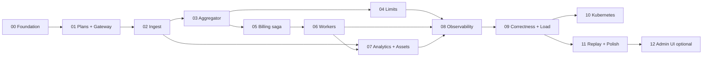

# Roadmap

12 core phases of ~1 week each for one developer, one optional phase, and phases 13–29 for the [billing platform](../14-billing-platform.md). Each phase ends with green CI and an
updated `docs/` (design changes discovered while building are written back into the docs in the same PR).

| # | Phase | Goal (short) | Depends on | Key proof | Status |
|---|---|---|---|---|---|
| 00 | [Foundation](phase-00-foundation.md) | Monorepo, toolchain, Compose stack, CI, observability skeleton | — | `make up` healthy, CI green, trace from a hello service visible in Tempo | done |
| 01 | [plans-svc + gateway](phase-01-plans-gateway.md) | Control plane, API keys, tenant resolution, rate limiting, RLS | 00 | RLS isolation suite. 429 under quota | done |
| 02 | [ingest-svc](phase-02-ingest.md) | Validated, deduplicated ingest with a transactional outbox to Kafka | 01 | Duplicate key counted once. Kafka outage loses nothing | done |
| 03 | [aggregator](phase-03-aggregator.md) | Exactly-once-effect aggregation with DB-stored offsets + inbox | 02 | Crash-after-commit test exact. Mini correctness test (100k) | done |
| 04 | [limits-svc](phase-04-limits.md) | Redis counters, limit-exceeded events, reconciliation | 03 | Thresholds fired once. Drift corrected | done |
| 05 | [billing-svc](phase-05-billing-saga.md) | Period close, watermark, late events, rating, saga with stub workers | 03 (04 optional) | Late event on next invoice. Saga state table tested | done |
| 06 | [RabbitMQ workers](phase-06-workers.md) | invoice-worker, payments-worker + mock-psp, notifier, TTL/DLX retries | 05 | `PAYMENT_UNKNOWN` never double-charges. DLQ after delivery limit | done |
| 07 | [analytics-svc + assets-svc](phase-07-analytics.md) | ClickHouse ingestion + query API. Multipart multi-file uploads to S3 | 02, 06 | Totals match aggregator after FINAL. Resumable parallel multipart upload | done |
| 08 | [Observability](phase-08-observability.md) | End-to-end traces incl. message headers, dashboards, SLOs, alerts | 00–07 | Single trace HTTP → Kafka → RabbitMQ → worker | done |
| 09 | [Correctness & load](phase-09-correctness-load.md) | 1M-event chaos suite, k6 scenarios, published benchmarks | 00–08 | All A1–A9 assertions pass nightly | done, nightly not yet run |
| 10 | [Kubernetes](phase-10-kubernetes.md) | kind cluster + Helm charts, chaos via pod deletion | 09 | Chaos suite passes on kind | done, `kind` CI job not yet green |
| 11 | [Replay, re-rating & polish](phase-11-replay-polish.md) | Generations, replay jobs, re-rating, demo, README | 03, 05, 09 | Re-rating idempotent. Replay promotes a corrected generation | done |
| 12 | [Admin UI (optional)](phase-12-admin-ui.md) | Minimal Next.js/TypeScript operator UI | 11 | Read-only views + DLQ redrive | done |
| 13 | [Customers, packages, subscriptions](phase-13-subscriptions.md) | Domain model, subscription state machine, package prices per currency, proration, invoice links | 05 | A trial, a pause and a mid-month plan change are invoiced correctly, in the subscription's currency | done |
| 14 | [Provider contract + iyzico](phase-14-provider-contract-iyzico.md) | Capabilities, webhook inbox, ledger, iyzico adapter, Quotify-owned dunning | 13 | Fixtures produce the right ledger rows, a redelivered charge never charges twice. Sandbox test runs when credentials exist | done, iyzico sandbox not run |
| 15 | [Paddle](phase-15-paddle.md) | Paddle adapter, provider-owned renewal and dunning, usage reporting | 14 | Signed Paddle webhooks link and follow a subscription. A charge Paddle accepted settles from its notification and is never charged twice | done, Paddle sandbox not run |
| 16 | [Routing and migration](phase-16-routing-migration.md) | Routing rules, preview, provider migration saga | 14, 15 | A migration never has two providers live at once: the old subscription is untouched until the new one is confirmed, and a failed step leaves one of them | done, not run against the sandboxes |
| 17 | [Reports](phase-17-reports.md) | Ledger events to ClickHouse, revenue/MRR/churn/dunning/reconciliation by provider, country, currency | 14 | Revenue, MRR and dunning figures by provider, country and currency; the reconciliation names every disagreement between the ledger and the invoices | done, read from the services' databases, not ClickHouse |
| 18 | [Billing console](phase-18-billing-console.md) | Customers, packages, subscriptions, payments, providers, reports pages on the shadcn-vue kit, six languages | 13–17 | Playwright against a mocked gateway: create package, subscribe, route, move, reconcile, read the reports | done |
| 19 | [Yearly and advance fees](phase-19-yearly-advance.md) | Yearly interval, anniversary anchor, fixed fee in advance, per-interval fees, period-start run | 13 | A yearly and a monthly subscription are invoiced once per period in advance, usage in arrears, with trial, pause and cancel | done |
| 20 | [Plan changes](phase-20-plan-changes.md) | Upgrade, downgrade, monthly↔yearly, quantity, timing and proration modes, preview, scheduled changes, credit balance | 19 | The preview equals the billed amount for every mode; a scheduled downgrade applies once at period end | done |
| 21 | [Paddle catalogue and subscription API](phase-21-paddle-api.md) | Products/prices/customers/discounts sync, every subscription operation, portal, extended webhooks | 15, 19, 20 | Publishing a plan creates Paddle products and prices; each operation has a fixture test; sandbox test skipped without credentials | done, Paddle sandbox not run |
| 22 | [Billing documents](phase-22-billing-documents.md) | Numbered invoices with typed lines, credit notes, coupons, PDF, outbound events, dunning settings, console | 19, 20 | A proration, a coupon and a credit note appear as lines on numbered invoices that the reconciliation accepts | done; outbound events, hosted page, dunning settings and card refunds came in phase 23 |
| 23 | [What 19–22 left out](phase-23-remaining-gaps.md) | Per-tenant dunning, credit for the unused prepaid fee, credit notes refunded to the card, signed outbound webhooks, hosted invoice page | 19–22 | Integration tests per part; a delivery is signed, retried on a backoff and redeliverable; a hosted link shows the invoice and nothing else | done, without quantity changes and tax calculation |
| 24 | [Foundations](phase-24-foundations.md) | Rename-able brand, YAML config defaults, error keys, Elastic License 2.0 | — | The brand changes without code; services start from YAML defaults; every error has a key | planned |
| 25 | [Addresses and apps](phase-25-accounts-apps.md) | Customer and seller addresses; apps under an account with their own keys and data | 24 | Two apps of one account are isolated; invoices show both addresses | done; the console pages came in phase 32 |
| 26 | [Demo mode and mail by provider](phase-26-demo-and-mail.md) | One-command demo, mail only for payments Quotify ran | 24 | Demo populated in one command; iyzico payments mail, Paddle's do not | done, without a per-tenant mail switch |
| 27 | [Development, Kubernetes, memory, edge](phase-27-dev-and-operations.md) | `make setup`/`make dev`, one-command k8s install, memory budgets, cacheable reads | 24 | Two commands to a dev stack; chart installs on kind; budgets enforced | done, memory budgets are limits, not enforced measurements |
| 28 | [Cells](phase-28-cells.md) | Tenant directory, schema-per-tenant mode, converted jobs, fenced moves | 24, 25 | Suites pass in both modes; cross-tenant read test; no row lost in a move | planned, staged |
| 29 | [Bank transfer](phase-29-bank-transfer.md) | `banktransfer` provider, manual receipts, offline payments, bank details on invoices | 14, 22, 23 | A transfer invoice goes pending → paid on a receipt; an unpaid one follows dunning | built; not run against a real bank |
| 31 | [Railway](phase-31-railway.md) | Config-as-code per service, backing-service images, bootstrap script, `PORT` support | 27 | Static checks pass in CI; the guide lists what only a real deploy can confirm | done statically, never deployed to Railway |
| 32 | [Console gaps](phase-32-console-gaps.md) | Console pages for apps and the seller address; API errors translated by key in six languages | 24, 25 | Mocked-gateway specs for both pages; a test fails when an error key has no translation | done, without app rename/delete (no API) |

## Changes from the suggested order (and why)

1. **Observability skeleton moved into Phase 00.** `slog` setup, OTel SDK init and the Kafka/AMQP header carriers are tiny but cross-cutting.
   Retrofitting trace propagation through the outbox in Phase 08 would mean touching every producer. Phase 08 remains for
   dashboards, SLOs, alerts and the end-to-end trace proof.
2. **A 100k-event mini correctness test lands in Phase 03**, not Phase 09. The exactly-once claim should be tested the moment it's built.
   Phase 09 scales it to 1M with chaos.
3. **Phase 05 uses stub workers** (an in-process fake that auto-replies on `billing.replies`) so the saga is fully testable before
   real workers exist. Phase 06 replaces the stubs and keeps them for fast tests.
4. **Generation-aware schema in Phase 03**, even though replay is built in Phase 11. Adding the `generation` column later would mean
   a migration on the largest tables and touching every query.
5. Phases 04 and 07 are independent of 05/06 and can be swapped if one runs long.

## Decisions confirmed before Phase 0 (2026-10-17)

| # | Question | Decision | Where |
|---|---|---|---|
| 1 | PDF storage | S3-compatible object storage via the S3 API only. MinIO in Compose and kind, any S3 endpoint by config | [ADR 0013](../adr/0013-s3-compatible-object-storage.md) |
| 2 | Payment testing | Per-account **sandbox** tenant with mock-psp, deterministic `pm_sandbox_*` scenarios, early period close. Also deployable on Kubernetes (`values-sandbox.yaml`) | [ADR 0011](../adr/0011-sandbox-environment.md) |
| 3 | Currency and periods | Chosen explicitly at account creation, no defaults: currency (immutable), time zone (immutable, calendar months in it), grace 0–7 days | [plans-svc](../03-services/plans-svc.md), [ADR 0010](../adr/0010-money-and-quantity-representation.md) |
| 4 | Replay source | Kafka retention (400 d on `usage.events.v1`, 30 d locally). No object-storage archive in v1 | [04-messaging.md](../04-messaging.md) |
| 5 | Quantities | **Fractional** quantities: per-meter `quantity_scale` 0–6, exact decimals in the API, scaled `int64` internally | [ADR 0010](../adr/0010-money-and-quantity-representation.md) |
| 6 | Idempotency key | Mandatory for live keys, optional in sandbox | [ingest-svc](../03-services/ingest-svc.md) |
| 7 | Generation scope | Per-tenant active generation, dual-write promotion without pausing live traffic | [ADR 0012](../adr/0012-per-tenant-aggregate-generations.md) |
| 8 | Idempotency table | Monthly partitions (benchmark vs. `DELETE` job recorded in Phase 02) | [05-data-model.md](../05-data-model.md#ingest_db) |
| 9 | Gateway HTTP layer | Hand-written `net/http` + hand-maintained OpenAPI with a contract test | [gateway](../03-services/gateway.md#why-a-hand-written-http-layer-not-grpc-gateway) |
| 10 | Schema registry | None in v1. `buf breaking` + golden fixtures in CI | [ADR 0007](../adr/0007-protobuf-event-schemas.md) |
| 11 | License | Apache-2.0, added at v0.1.0 (public release) | [README](../../README.md) |
| 12 | Asset uploads | Multipart and multi-file: presigned S3 multipart sessions (≤ 50 files, parallel, resumable) plus streamed `multipart/form-data` (≤ 20 small files) | [assets-svc](../03-services/assets-svc.md), [ADR 0013](../adr/0013-s3-compatible-object-storage.md) |

## Buffer and scope control

- ~12 weeks total. If behind schedule, cut in this order: Phase 12 → Phase 07 query API breadth (keep ingestion) →
  KEDA/HPA niceties in Phase 10 → dunning beyond one retry in Phase 06.
- **Never cut:** the Phase 03 and Phase 09 correctness tests. They're the point of the project.

## Definition of done (every phase)

- Acceptance criteria in the phase file are met and **covered by automated tests** where marked.
- `make lint test test-integration` green locally and in CI.
- Docs updated: service spec, messaging, data model, and any new ADR.
- Phase checklist boxes ticked in the phase file in the closing PR.
