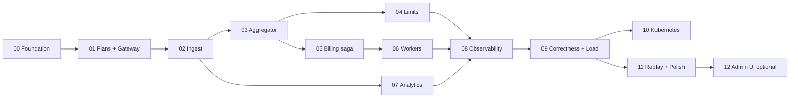

# Roadmap

12 core phases of ~1 week each for one developer, plus one optional phase. Each phase ends with green CI and an
updated `docs/` (design changes discovered while building are written back into the docs in the same PR).

| # | Phase | Goal (short) | Depends on | Key proof |
|---|---|---|---|---|
| 00 | [Foundation](phase-00-foundation.md) | Monorepo, toolchain, Compose stack, CI, observability skeleton | — | `make up` healthy, CI green, trace from a hello service visible in Tempo |
| 01 | [plans-svc + gateway](phase-01-plans-gateway.md) | Control plane, API keys, tenant resolution, rate limiting, RLS | 00 | RLS isolation suite. 429 under quota |
| 02 | [ingest-svc](phase-02-ingest.md) | Validated, deduplicated ingest with a transactional outbox to Kafka | 01 | Duplicate key counted once. Kafka outage loses nothing |
| 03 | [aggregator](phase-03-aggregator.md) | Exactly-once-effect aggregation with DB-stored offsets + inbox | 02 | Crash-after-commit test exact. Mini correctness test (100k) |
| 04 | [limits-svc](phase-04-limits.md) | Redis counters, limit-exceeded events, reconciliation | 03 | Thresholds fired once. Drift corrected |
| 05 | [billing-svc](phase-05-billing-saga.md) | Period close, watermark, late events, rating, saga with stub workers | 03 (04 optional) | Late event on next invoice. Saga state table tested |
| 06 | [RabbitMQ workers](phase-06-workers.md) | invoice-worker, payments-worker + mock-psp, notifier, TTL/DLX retries | 05 | `PAYMENT_UNKNOWN` never double-charges. DLQ after delivery limit |
| 07 | [analytics-svc](phase-07-analytics.md) | ClickHouse ingestion + query API | 02 | Totals match aggregator after FINAL |
| 08 | [Observability](phase-08-observability.md) | End-to-end traces incl. message headers, dashboards, SLOs, alerts | 00–07 | Single trace HTTP → Kafka → RabbitMQ → worker |
| 09 | [Correctness & load](phase-09-correctness-load.md) | 1M-event chaos suite, k6 scenarios, published benchmarks | 00–08 | All A1–A9 assertions pass nightly |
| 10 | [Kubernetes](phase-10-kubernetes.md) | kind cluster + Helm charts, chaos via pod deletion | 09 | Chaos suite passes on kind |
| 11 | [Replay, re-rating & polish](phase-11-replay-polish.md) | Generations, replay jobs, re-rating, demo, README | 03, 05, 09 | Re-rating idempotent. Replay promotes a corrected generation |
| 12 | [Admin UI (optional)](phase-12-admin-ui.md) | Minimal Next.js/TypeScript operator UI | 11 | Read-only views + DLQ redrive |

## Changes from the suggested order (and why)

1. **Observability skeleton moved into Phase 00.** `slog` setup, OTel SDK init and the Kafka/AMQP header carriers are tiny but cross-cutting.
   Retrofitting trace propagation through the outbox in Phase 08 would mean touching every producer. Phase 08 remains for
   dashboards, SLOs, alerts and the end-to-end trace proof.
2. **A 100k-event mini correctness test lands in Phase 03**, not Phase 09. The exactly-once claim should be tested the moment it's built.
   Phase 09 scales it to 1M with chaos.
3. **Phase 05 uses stub workers** (an in-process fake that auto-replies on `billing.replies`) so the saga is fully testable before
   real workers exist. Phase 06 replaces the stubs and keeps them for fast tests.
4. **Generation-aware schema in Phase 03**, even though replay is built in Phase 11. Adding the `generation` column later would mean
   a migration on the largest tables and touching every query.
5. Phases 04 and 07 are independent of 05/06 and can be swapped if one runs long.

## Buffer and scope control

- ~12 weeks total. If behind schedule, cut in this order: Phase 12 → Phase 07 query API breadth (keep ingestion) →
  KEDA/HPA niceties in Phase 10 → dunning beyond one retry in Phase 06.
- **Never cut:** the Phase 03 and Phase 09 correctness tests. They're the point of the project.

## Definition of done (every phase)

- Acceptance criteria in the phase file are met and **covered by automated tests** where marked.
- `make lint test test-integration` green locally and in CI.
- Docs updated: service spec, messaging, data model, and any new ADR.
- Phase checklist boxes ticked in the phase file in the closing PR.
